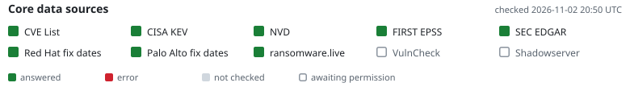
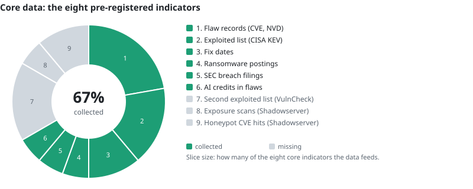
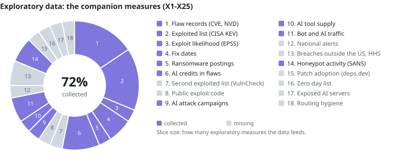

# Internet Security Snapshot

<picture>
  <source media="(prefers-color-scheme: dark)" srcset="https://raw.githubusercontent.com/pagagne/internet-security-snapshot/run-reports/landing/banner-dark.svg">
  
</picture>

## Mission

Artificial intelligence has officially entered the cybersecurity fight. No one can say exactly
when it started, but 2026 unleashed an [unprecedented wave](https://www.webull.com/news/15712183178626048)
of [global data breaches](https://www.helpnetsecurity.com/2026/07/30/ibm-cost-of-a-data-breach-2026/)
and [AI-driven attacks](https://www.techrepublic.com/article/news-verizon-dbir-vulnerability-exploitation-2026/),
and [experts warn](https://www.ncsc.gov.uk/pdfs/report/impact-ai-cyber-threat-now-2027.pdf) that 2027
will escalate even faster and at a much greater scale.
The mission is to measure the internet's vulnerability lifecycle and plot the cybersecurity shift
quarter by quarter, using free, public reporting services from the US and around the world.

The Internet Security Snapshot tracks the health of internet security through 2027. Every
quarter it answers one critical question: are defenders closing internet-exposed flaws faster
than attackers can exploit them, and how is AI changing the race?

At its core, it answers using only free, public data, under a plan pre-registered with the Open
Science Framework (OSF, DOI [10.17605/OSF.IO/3XT82](https://doi.org/10.17605/OSF.IO/3XT82),
20 October 2026), so the findings cannot be shaped to fit a conclusion.

The study tracks ten core datasets. Seven are collected now:

1. **Flaw records:** public records of software flaws, from CVE.org and NVD, plus CISA's
   Vulnrichment analysis.
2. **Known-exploited flaws:** flaws confirmed as attacked in the wild, from CISA's Known
   Exploited Vulnerabilities (KEV) catalog.
3. **Exploit likelihood:** daily exploitation-probability scores, from EPSS.
4. **Fix dates:** when vendors released fixes, from vendor advisories.
5. **Ransomware postings:** victim claims on leak sites, counted only (no victim names), from
   ransomware.live (with written permission, 27 October 2026).
6. **Breach filings:** material cybersecurity incidents disclosed by companies, from SEC
   filings.
7. **AI credits:** AI tools credited in flaw records.

Three are pending permission:

8. **Exploited flaws, second source:** independent exploitation evidence, from VulnCheck.
9. **Exposure scans:** how many internet systems are still exposed to a flaw, from Shadowserver.
10. **Honeypot hits:** real-world attack observations, from Shadowserver's honeypots.

**Yearly cross-check:** internet scan data for the exposure reference. Censys declined research access on 10 Nov 2026; the author decides at the 15 March 2027 review whether to reapply, license it, or drop it.

**International views, being tested:** national alerts on actively exploited flaws from France
(CERT-FR) and Japan (JPCERT/CC); routing security by country from APNIC Labs (with written
permission, 1 November 2026); regional splits of web traffic and ransomware postings; and
data-breach notifications from the UK (ICO) and Australia (OAIC).

Each quarter, an automatic GitHub job freezes an exact copy of the data, the author checks by
hand what automation cannot judge, and the seven pre-registered questions are reported: a
provisional evaluation on the 1st of January, April, July and October, and a final one a month
later. Q4 2026 is a labelled pilot; Q1 2027 is the first scored quarter. Additional context comes
from news reporting, internet traffic data from Cloudflare Radar, and open repositories of
software code and AI models and datasets.

## Data coverage: what the study collects so far

Two rings, kept apart and never combined. Each slice is one kind of data the study needs; a slice
is coloured only when a quarterly pull or a sweep actually collects that data, and gray while it
is still missing. A slice's size is how many measures in its ring the data feeds, and the number
in the middle is the share of the ring that is collected.

<picture>
  <source media="(prefers-color-scheme: dark)" srcset="docs/landing/coverage-core-dark.svg">
  
</picture>

**Reading the core ring.** The core is the data behind the eight pre-registered indicators that
the study is scored on: flaw records, the exploited-flaw lists, exploit likelihood, fix dates, ransomware postings,
company breach filings and AI credits. Gray slices are mostly sources still waiting for permission
(Shadowserver) or not yet collected (VulnCheck, from the 1 December 2026 dry run).

<picture>
  <source media="(prefers-color-scheme: dark)" srcset="docs/landing/coverage-exploratory-dark.svg">
  
</picture>

**Reading the exploratory ring.** The exploratory work is the companion measures (X1-X27) that
add context but never decide a label: AI attack campaigns, AI tools on GitHub and Hugging Face,
bot traffic, honeypot activity, views from other countries and more. Data used by both rings,
such as flaw records, appears in both. Gray slices are collectors not yet built or sources not yet
in use.

**How the rings change.** The rings are redrawn whenever `config/coverage.yaml` changes. A slice turns
from gray to colour when its data starts arriving (for example, when Shadowserver or VulnCheck
grant permission and their collectors run), and back to gray if a source stops or is withdrawn.
A slice grows when a new measure starts using that data and shrinks when one is retired, and new
kinds of data join as new slices. So the middle numbers rise as the study fills its gaps, and drop
if a source is lost. The banner above tells the day-to-day story: whether each core source
answered today. Dated copies of the pictures, with what changed between them, are kept at the
cutover, the pilot run and every quarterly run:
[what changed](https://github.com/pagagne/internet-security-snapshot/blob/run-reports/landing/CHANGES.md).

**Standard operating procedure:** [`docs/SOP_MANUAL_RUNS.md`](docs/SOP_MANUAL_RUNS.md), how
every workflow is run, checked and recovered. The banner is redrawn daily by the Source status
workflow; the rings come from `config/coverage.yaml` (`docs/WORKFLOWS.md`, section 14).

## Key documents

- **How it works (plain-language overview with diagrams):** [`docs/HOW_IT_WORKS.md`](docs/HOW_IT_WORKS.md)
- **Pre-registration:** [`prereg/PREREGISTRATION.md`](prereg/PREREGISTRATION.md)
  (v1.0, tag `prereg-v1.0`), registered on OSF on 20 October 2026:
  [doi.org/10.17605/OSF.IO/3XT82](https://doi.org/10.17605/OSF.IO/3XT82)
  (project: [osf.io/3smuq](https://osf.io/3smuq))
- **Deviations log:** [`prereg/DEVIATIONS.md`](prereg/DEVIATIONS.md)
- **Change policy:** [`docs/CHANGE_POLICY.md`](docs/CHANGE_POLICY.md): a locked core
  (baseline `core-v1.1`, checksums in `prereg/LOCKED.yaml`) and an exploratory add-on
  layer (`config/exploratory.yaml`) that never decides a label
- **Hand checks:** criteria in [`docs/HAND_CHECK.md`](docs/HAND_CHECK.md); the author works
  through them in the Hand Check app (user guide kept privately)
- **Cohort rules:** [`config/cohort_rules.yaml`](config/cohort_rules.yaml),
  [`config/ai_credit_terms.yaml`](config/ai_credit_terms.yaml),
  [`config/root_cause_map.yaml`](config/root_cause_map.yaml)

## Data sources

Status as of 26 Oct 2026. Terms, requests and replies are logged in
[`docs/PERMISSIONS.md`](docs/PERMISSIONS.md); this table is updated with it. "Core" sources feed
the pre-registered measures; "exploratory" ones are reported separately and never decide a label
([`config/exploratory.yaml`](config/exploratory.yaml)).

### In use: free and public (ransomware.live with written permission)

| Source | What it gives the study | Role |
|---|---|---|
| CVE.org records (CVEProject/cvelistV5) | New flaws (T5), finder credits for AI involvement (T7), cohort dates and bug types | Core |
| CISA Known Exploited Vulnerabilities (KEV) | First-attack dates for the race (T1a), time to exploitation (T3), age of exploited flaws (T4) | Core |
| CISA Vulnrichment | CISA's "active exploitation" flag; bug type and severity where the CVE record lacks them | Core |
| NVD API 2.0 | Severity, bug type and product matching (fallback) | Core |
| FIRST EPSS | Daily exploitation-likelihood scores | Context |
| SEC EDGAR | Breach filings, 8-K Item 1.05 (T6b) | Core |
| Cloudflare Radar | Internet-wide attack and traffic trends | Context |
| Vendor advisories and GitHub/OSV (Microsoft, Cisco, Palo Alto, GitHub advisories) | Fix dates for the race | Core |
| Exploit-DB, Metasploit, Nuclei, GitHub | Dates public exploit code appeared | Core (cohort), exploratory (X7) |
| Linux kernel commits | Fix dates for Linux flaws (being added, Nov 2026) | Core (fix-date pre-fill) |
| Google Project Zero "0day In the Wild" | Independent check of the zero-day share | Exploratory (X15) |
| SANS Internet Storm Center web honeypot | Attack activity by category, monthly, aggregates only | Exploratory, context (X14) |
| deps.dev and OSV | Patch adoption for open-source packages (in testing) | Exploratory (X16) |
| HTTP Archive and WordPress.org statistics | Patch adoption on websites (in testing) | Exploratory |
| HHS OCR breach register | Health-sector hacking breaches (in testing) | Exploratory (X17) |
| [ransomware.live](https://www.ransomware.live) (with permission, 27 Oct 2026) | Ransomware leak-site postings, aggregate counts only, credited (T6a) | Core |

### Sources that need permission or access

| Source | What it would give the study | Request | Status |
|---|---|---|---|
| Shadowserver | Exposure series (T1b, T2) and honeypot attack statistics (T1, T3, T4) | Asked 20 Oct 2026 | <!-- status:shadowserver -->Awaiting<!-- /status --> reply (form sent 10 Nov); follow-up <!-- date:shadowserver-follow-up-2 -->1 Dec<!-- /date --> |
| VulnCheck KEV (community) | Earlier exploitation dates (T1, T3); agreement checks | Asked 20 Oct 2026 | <!-- status:vulncheck -->Granted<!-- /status --> 11 Nov 2026 (attribution only); derived figures credited "VulnCheck KEV", entries not republished |
| Censys | Internet exposure counts (T1b, T2) and the annual check | Applied 28 Oct 2026 | Declined 10 Nov 2026; the author decides at the 15 March 2027 review whether to reapply |
| GreyNoise | Attack activity by CVE (exploratory) | Requested 29 Oct 2026 | Awaiting reply; follow-up <!-- date:permission-follow-ups-exploratory -->13 Nov<!-- /date --> |
| CrowdSec | Exploitation timelines by CVE (exploratory) | Requested 29 Oct 2026 | Awaiting reply; follow-up <!-- date:permission-follow-ups-exploratory -->13 Nov<!-- /date --> |

Each source above has an on/off switch in [`config/sources.yaml`](config/sources.yaml); nothing derived
from one is published until its permission is granted.

### Being tested: views beyond the US (added 26 Oct 2026)

| Source | What it would give the study | Role |
|---|---|---|
| CERT-FR, JPCERT/CC, BSI, KrCERT/CC alerts | Other countries' active-exploitation alerts, compared with CISA KEV | Exploratory (X19) |
| APNIC Labs (written permission 1 Nov 2026; RIPE NCC not used, its terms forbid redistribution) | DNSSEC validation and RPKI route checking by country | Exploratory (X20), collector to build by <!-- date:x20-collector -->25 Nov<!-- /date --> |
| Cloudflare Radar and ransomware.live by region | Attack, bot and ransomware trends by world region | Exploratory (X21) |
| UK ICO, OAIC, PDPC, ENISA | Data-breach notifications outside the US | Exploratory (X22) |
| Quarterly web sweep, nine languages | AI-run attack reports outside the usual channels | Exploratory (X3) |

A source without a written yes by the <!-- date:freeze-session -->21 Dec 2026<!-- /date --> decision session runs without it for the
Q4 2026 pilot; a later yes is switched on at the next quarter's run. Gaps are never filled by
estimation.

## Schedule

<!-- schedule:begin -->
<!-- Generated from docs/schedule/schedule.yaml (milestones); edit there, then run python -m snapshot.schedule build. -->
| Date | Milestone |
|---|---|
| 20 Oct 2026 | Pre-registration registered on OSF (DOI 10.17605/OSF.IO/3XT82) |
| 28 Oct 2026 | Censys research-access application sent (written by the author) |
| 30 Nov 2026 | Cutover - the repository's schedule runs the study (docs/OPERATIONS.md) |
| 1 Dec 2026 | Dry run on Oct-Nov 2026 data (unscored; started by the Schedule workflow) |
| 4 Dec 2026 | Public landing page (GitHub Pages) and Discussions opened; project links shared from here on |
| 15 Dec 2026 | Full dry run with all available sources (1 Oct-14 Dec data; unscored) |
| 21 Dec 2026 | Core-freeze decision session (docs/CORE_FREEZE_DECISIONS.md) |
| 29 Dec 2026 | Final core freeze: tag core-v1.2, OSF update |
| 1 Jan / 1 Feb 2027 | Q4 2026 pilot: provisional / final |
| 1 Mar 2027 | External reviewer confirmed (decision item 17) |
| 15 Mar 2027, then yearly | Annual review and change window; annual check of free numbers from March 2028 |
| 1 Apr / 1 May 2027 | Q1 2027, first scored (confirmatory) quarter: provisional / final, with the external review published beside the final |
| 3-28 Apr 2027 | Independent external review of the Q1 2027 provisional report |
| 1 Feb 2028 | Q4 2027 final: last quarter of the first year |
| 1 Apr 2028 | 2027 closing re-run with full follow-up |
<!-- schedule:end -->

## Workflow schedule

The study runs on GitHub workflows: automatic jobs that collect, check, back up and publish.

<!-- workflows:begin -->
<!-- Generated from .github/workflows/*.yml by python -m snapshot.workflows build; do not edit here. -->
| Workflow | Timer | Also runs |
|---|---|---|
| Backup to Google Drive | the 3rd of each month at 10:17 UTC | Run button |
| BigQuery check | no timer | started by the Schedule workflow or Claude |
| Checks | no timer | after changes to main, on pull requests, Run button |
| Diagrams | no timer | after changes to main, Run button |
| Feed screen | the 5th of each month at 08:41 UTC | started by the Schedule workflow or Claude |
| Honeypot capture | the 2nd of each month at 09:43 UTC | started by the Schedule workflow or Claude |
| Landing snapshot | no timer | started by the Schedule workflow or Claude, Run button |
| Manual publish (private) | no timer | after changes to main, started by the Schedule workflow or Claude, Run button |
| Privacy scan | daily at 21:13 UTC; daily at 23:51 UTC | Run button |
| Quarterly pull | 1st Jan/Apr/Jul/Oct at 06:00 UTC; 1st Feb/May/Aug/Nov at 06:00 UTC | started by the Schedule workflow or Claude |
| Rebuild check | the 10th of each month at 07:17 UTC | Run button |
| Research probe | no timer | started by the Schedule workflow or Claude |
| Schedule | daily at 15:37 UTC; daily at 20:07 UTC; daily at 21:23 UTC; daily at 22:37 UTC; daily at 23:43 UTC | Run button |
| Source status | daily at 21:47 UTC | started by the Schedule workflow or Claude |
| Source watch | Wednesdays at 13:17 UTC | started by the Schedule workflow or Claude |

Details for each workflow: [`docs/WORKFLOWS.md`](docs/WORKFLOWS.md). Dates for scheduled runs without a timer (dry runs, sweeps, landing snapshots) are in the schedule above.
<!-- workflows:end -->

## Principles

- Free data and free infrastructure only; nothing is estimated to fill a gap.
- Rates with stated denominators, not raw counts.
- Raw inputs frozen with checksums; every published number reproducible with one command.
- All seven tracking questions reported every quarter, whatever the result.
- No scanning, no exploitation, no host-level data, no victim names.
- Private by design: data a provider has not yet allowed us to publish, and personal details,
  never appear in this repository or its public run outputs. They are kept in a private backup
  (setup notes kept privately); a scan on every change and every day checks this
  ([`docs/OPERATIONS.md`](docs/OPERATIONS.md), "Private by design").

## About the author

**Paul A. Gagne** retired from the U.S. Navy after 20 years as a quartermaster (Petty Officer
Second Class). From 2005 to 2009 he worked in Baghdad as an IT contractor supporting the U.S.
Army Corps of Engineers and the U.S. Embassy, and he later retired from the SANS Institute, where
he was a systems administrator on the operations team. He holds an associate degree in applied
science (chemical technology) from the Community College of Rhode Island and has more than 30
years in IT. He now runs the Internet Security Snapshot, a free, independent study of how quickly
software flaws are fixed compared with how quickly attackers exploit them, and how AI is changing
that race.

 

## AI involvement and conflict of interest

Code and draft evaluations are written with Claude, an AI model made by Anthropic.
Anthropic is named in the report this study grew from. Safeguards: the frozen
pre-registration, public code, the author's approval of every release, and an external
reviewer for the first confirmatory quarter.

## Licence

Code: MIT (see `LICENSE`). Documentation and the study's own derived data: CC BY 4.0.
Third-party data keeps its own terms; see [`docs/PERMISSIONS.md`](docs/PERMISSIONS.md).
