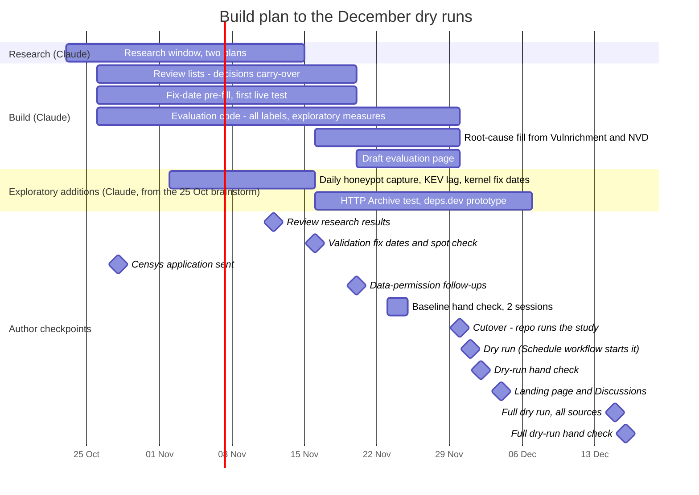

# Build plan to the December dry runs

Blue bars are build work by Claude; the yellow band holds the author's dated checkpoints.
On GitHub the red line marks today.

| By | Item | Status |
|---|---|---|
| 24 Oct | Pinned environment: hash-locked requirements, Actions pinned by commit, Python 3.12.15, environment recorded in every manifest; pinned container tested on every push, monthly rebuild check | done 2026-10-24 |
| 24 Oct | Hand-check reliability: 20 re-shown items a quarter across credits, fix dates and slot c; blinded second-coder sample with agreement scores (second coder lined up with the external reviewer) | done 2026-10-24 |
| 24 Oct | Statistical review response: companion check beside each label (item 19), interval dates and X13 (item 20), 2027 closing re-run (item 21) | done 2026-10-24; decisions on 21 Dec |
| 24 Oct | Schedule as code: every action item in `docs/schedule/schedule.yaml`, generated annual plan and shared calendar feed, daily Schedule workflow opening issues and starting dispatched runs; runbook `docs/OPERATIONS.md`; project documents copied to `docs/artifacts/` | done 2026-10-24; cutover 30 Nov |
| 15 Nov | Reference dates for five validation cases (`prereg/ground_truth_reference.csv`) | done 2026-10-22 |
| 3 Nov (moved up from 16 Nov, 29 Oct) | Validation batch in the Hand Check app: the author records fix dates for the reference CVEs before opening the reference file | batch loaded 2026-10-22; author step 16 Nov |
| 20 Nov | Cohort draw over real data; `review/baseline.csv` and quarterly review files; `review/decisions.csv` carry-over | builder done (`snapshot.review`); carry-over to do |
| 20 Nov | Drift checks in the quality report: expected fields present per source, counts compared with the previous run (from the `run-reports` branch), sharp changes flagged | done 2026-10-22 |
| 20 Nov | Pre-filled fix dates in review lists: GitHub releases, advisories and commits (built 2026-10-22); for exploited CVEs also Microsoft's Update Guide, Cisco CSAF and Palo Alto advisories, then the CVE's disclosure date, else marked as assumed, with fix-later signals flagged for hand check (built 2026-10-23, `fixdates.prefill_exploited`) | built; first live test pending |
| 20 Nov | Picks recorded "no fix yet" return to the review list for a fix date in later runs (within the 90-day follow-up) | done 2026-10-22 |
| 30 Nov | Evaluation code: T1-T7 labels, bootstrap intervals, exploratory X1-X12. Built 2026-10-22: events (`snapshot.events`), validation (`snapshot.validate`), T1(a)/T3 (`snapshot.race`), T7 range and programme-evidence figure (`snapshot.t7`), consistency rate | in progress |
| 30 Nov | T1(a) as decided 23 Oct: median days from fix to first attack over all CVEs first added to KEV in the quarter (vendor fix dates, flagged ones to the hand check), next to the registered cohort version; X10 zero-day share computed as exploratory | computation built 2026-10-24 (`snapshot.race.t1_kev_race`, with fix-date and attack-date bounds from `snapshot.events`); list builder and report table to do |
| 30 Nov | Draft evaluation page for the dry run | to do |
| 11-15 Dec | Full dry run (author's request, 26 Oct): every available source, core and exploratory, collected by the pull or its own workflow, and the whole evaluation run end to end; 15 Dec run, Claude's findings the same day, author's hand check 16 Dec, decisions 21 Dec | to do |
| 2 Nov-7 Dec | Exploratory additions adopted 25 Oct (brainstorm): daily SANS ISC honeypot capture, KEV-lag back-test (EUVD, Project Zero, inthewild.io), Linux kernel and distribution fix dates, HTTP Archive version test, deps.dev patch adoption; each registered in `config/exploratory.yaml` before its first result; collectors tested before the 14 Dec workflow review | to do |
| 30 Nov | Root cause: fill missing CWEs from Vulnrichment then NVD (registered source order) in the evaluation | to do |
| 4-18 Dec | **Author:** from 4 Dec (project links public; the repository itself is already public), sign in to zenodo.org with GitHub and switch on archiving for `internet-security-snapshot` (about 2 minutes); first archived release = Q4 2026 final, 1 Feb 2027 | to do |
| 27 Oct | Private by design (non-publishable data out of public outputs), privacy scan (every push and daily), workflow security review and fixes, private Google Drive backup with the author's own client ID | done 2026-10-27 (#26, #27; `docs/WORKFLOW_REVIEW_2026-10-27.md`) |
| 31 Dec | Zenodo archiving: quarterly workflow publishes a GitHub release on each final run; `.zenodo.json` metadata (title, author, licence, OSF link); check whether the data bundle can ride the release or needs Zenodo's upload API (a `ZENODO_TOKEN` secret), keeping only publishable data (no VulnCheck, ransomware.live aggregates only and only once permitted); also archive the pinned container image (`docker save`) with each final release | to do |
| 31 Dec | Quarter archive: a quarter-by-quarter index page on the project site (GitHub Pages), one entry per provisional and final report; the Q4 2026 pilot is the first entry | to do |
| 31 Dec | Cohort timelines: one timeline per sampled flaw (published, fixed, first attacked; exposure added once scan data arrives), linked from each quarter's report | to do |
| 31 Dec | Review gate: the automatic run on the 1st produces a draft; the evaluation page is published only after the author's review (within two days) | to do |

Author checkpoints: 3 Nov reference-date spot check (moved up from 16 Nov), 23-24 Nov baseline-year hand check (two sessions),
1 Dec dry run, 2 Dec dry-run hand check, 4 Dec landing page, 4-18 Dec switch on Zenodo archiving,
16 Dec full dry-run hand check.

Research window 23 Oct - 15 Nov (two plans: with and without data permissions): see `docs/RESEARCH_PLAN.md`; review 12 Nov.
