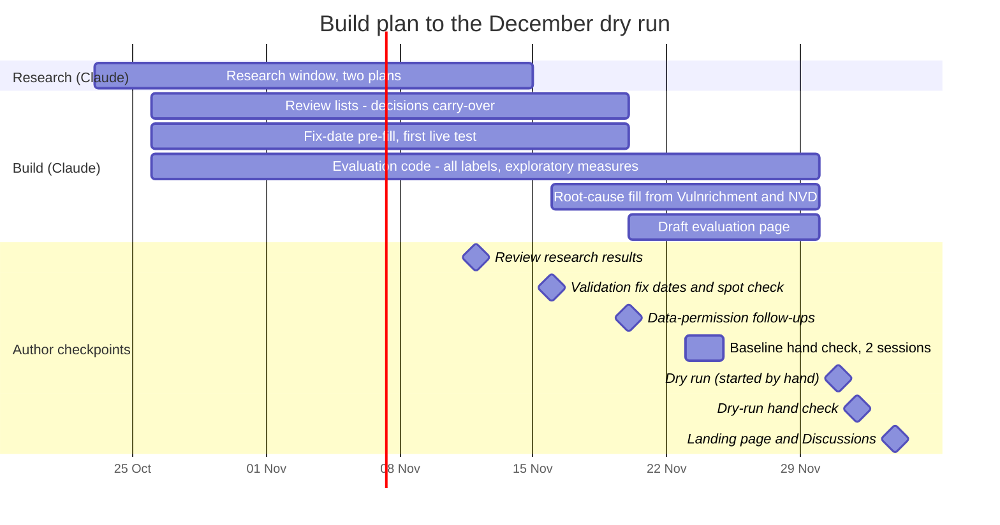

# Build plan to the December dry run

Blue bars are build work by Claude; the yellow band holds the author's dated checkpoints.
On GitHub the red line marks today.

| By | Item | Status |
|---|---|---|
| 15 Nov | Reference dates for five validation cases (`prereg/ground_truth_reference.csv`) | done 2026-10-22 |
| 20 Nov | Cohort draw over real data; `review/baseline.csv` and quarterly review files; `review/decisions.csv` carry-over | builder done (`snapshot.review`); carry-over to do |
| 20 Nov | Drift checks in the quality report: expected fields present per source, counts compared with the previous run (from the `run-reports` branch), sharp changes flagged | done 2026-10-22 |
| 20 Nov | Pre-filled fix dates in review lists (GitHub releases, advisories, commits; else marked as assumed) | built 2026-10-22; first live test pending |
| 30 Nov | Evaluation code: T1-T7 labels, bootstrap intervals, exploratory X1-X12. Built 2026-10-22: events (`snapshot.events`), validation (`snapshot.validate`), T1(a)/T3 (`snapshot.race`), T7 range and programme-evidence figure (`snapshot.t7`), consistency rate | in progress |
| 30 Nov | Draft evaluation page for the dry run | to do |
| 30 Nov | Root cause: fill missing CWEs from Vulnrichment then NVD (registered source order) in the evaluation | to do |
| 20 Nov | Picks recorded "no fix yet" return to the review list for a fix date in later runs (within the 90-day follow-up) | done 2026-10-22 |
| 31 Dec | Zenodo archiving: quarterly workflow publishes a GitHub release on each final run; `.zenodo.json` metadata (title, author, licence, OSF link); check whether the data bundle can ride the release or needs Zenodo's upload API (a `ZENODO_TOKEN` secret), keeping only publishable data (no VulnCheck, ransomware.live aggregates only and only once permitted) | to do |
| 31 Dec | Quarter archive: a quarter-by-quarter index page on the project site (GitHub Pages), one entry per provisional and final report; the Q4 2026 pilot is the first entry | to do |
| 31 Dec | Cohort timelines: one timeline per sampled flaw (published, fixed, first attacked; exposure added once scan data arrives), linked from each quarter's report | to do |
| 31 Dec | Review gate: the automatic run on the 1st produces a draft; the evaluation page is published only after the author's review (within two days) | to do |
| 4-18 Dec | **Author:** after the repository goes public on 4 Dec, sign in to zenodo.org with GitHub and switch on archiving for `internet-security-snapshot` (about 2 minutes); first archived release = Q4 2026 final, 1 Feb 2027 | to do |
| 16 Nov | Validation batch in the Hand Check app: the author records fix dates for the reference CVEs before opening the reference file | batch loaded 2026-10-22; author step 16 Nov |

Author checkpoints: 16 Nov reference-date spot check, 23-24 Nov baseline-year hand check (two sessions),
1 Dec dry run, 2 Dec dry-run hand check, 4 Dec landing page, 4-18 Dec switch on Zenodo archiving.

Research window 23 Oct - 15 Nov (two plans: with and without data permissions): see `docs/RESEARCH_PLAN.md`; review 12 Nov.
