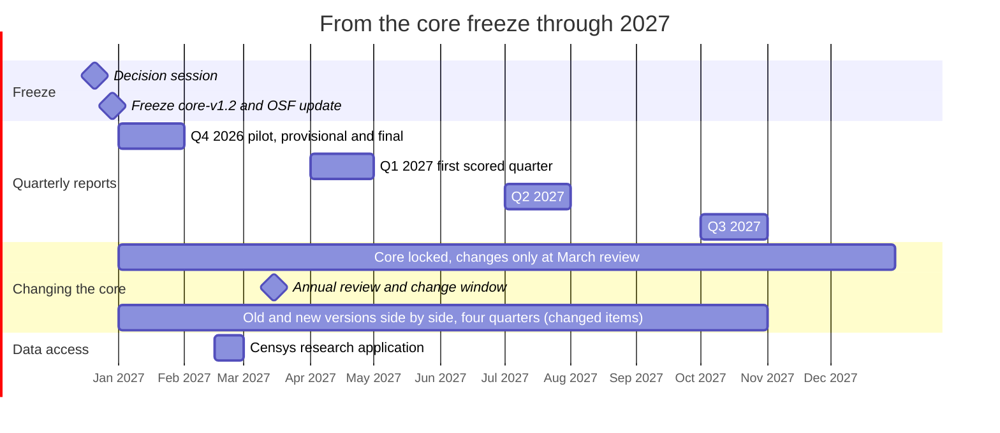

# Core freeze: decisions before scoring starts

The core (rules that decide the Improving/Worsening labels) must be final before the
Q4 2026 pilot is scored on 1-2 January 2027. After the freeze it changes only at a March
review (docs/CHANGE_POLICY.md). The exploratory layer stays open at all times.

- **Decision session:** 21 December 2026
- **Freeze:** by 31 December 2026 — tag `core-v1.2`, update `prereg/LOCKED.yaml`,
  log in `prereg/DEVIATIONS.md`, file an update on OSF.

After the freeze the core stays locked all year. The only change window is the annual
review on 15 March; any core item changed there (or on 21 Dec) is reported in old and new
form side by side for four quarters. The exploratory layer can change at any time.

Each item: decide **promote to core**, **keep exploratory**, or **drop**. Evidence comes
from the December dry run and the test runs.

| # | Item | Now | Question for the session | Evidence to bring |
|---|---|---|---|---|
| 0 | **T1(a) cannot be estimated from the cohort** | Core | Test on Q3 2026: none of the 11 cohort picks reached CISA KEV within follow-up (fewer than 1% of serious CVEs are ever listed), so the registered T1(a) median (patch to exploit across cohort CVEs) is undefined almost every quarter. Options: (a) compute T1(a) on all CVEs first exploited in the quarter (about 100 KEV additions), with fix dates pre-filled automatically and a hand-checked sample; keep the cohort for exposure (T1b, T2) and description; (b) keep as registered and report it as mostly censored; (c) larger cohort; (d) weighted cohort (EPSS-weighted draw, back-tested 2026-10-22: 2-3 exploited picks per quarter but the race estimate stays far too uncertain; would break the EPSS rule); (a+d) combined. | `proposals/T1_OPTIONS.md` (Q3: 0.42% of eligible CVEs exploited; registered cohort averages 0.3-0.4 exploited picks per quarter; back-test table for Q2 and Q3 2026); diagram: `docs/EVALUATION_FLOW.md` §2 |
| 1 | Root-cause map coverage | Core | Adopt map v1.1 (`proposals/root_cause_map_v1.1.yaml`)? It cuts "other/unknown" from 29% to 14% of eligible CVEs (Q3 2026). NVD fill is already in the registered source order and will be implemented regardless (small effect: 11.6% to 10.7% with no CWE). | `proposals/ROOT_CAUSE_MAP.md` |
| 2 | T6(b) SEC Item 1.05 | Core | Keep as is, or add voluntary Item 8.01 cyber disclosures alongside? (Q3 2026, after the collector was fixed to search each form separately: 11 filings, 7 of them original reports) | Next run's SEC diagnostics |
| 3 | X6 Speed in the tail | Exploratory | Promote? It is tool-agnostic and catches faster attackers, incl. self-hosted models | Q3 2026 and baseline-year values |
| 4 | X7 Patch to public exploit code | Exploratory | Keep exploratory until a year of data shows it is stable? | Coverage of PoC-in-GitHub for cohort CVEs |
| 5 | X8 Breadth of exploitation | Exploratory | Promote or keep? | Quarter-to-quarter noise in baseline year |
| 6 | X9 Bug types exploited | Exploratory | Depends on item 1 | — |
| 7 | X10 Zero-day share | Exploratory | Feasible with free fix dates? | Share of unknown fix dates |
| 8 | X3 AI-run campaign log, X5 AI software, X11, X12 | Exploratory | Stay exploratory (curated or context) | — |
| 9 | AI credit term list | Core (v1.2) | Promote any watchlist candidates seen in credits by December? | Watchlist scan from the dry run |
| 10 | Slot (a) keyword "gateway" | Core | Too broad: the Q3 preview put Jupyter Enterprise Gateway (a data-science server) in the edge-device slot. Match "gateway" only with VPN/remote-access/SSL/security words? | Edge-slot picks from the baseline preview |
| 11 | Internet-facing rule for slot (d) | Core | Does the internet-facing requirement apply to AI-credited picks too? The preview offered Firefox and FreeBSD. | Slot d candidates in the baseline |
| 12 | Automatic yes for clear-cut AI credits | Core (adopted 2026-10-22) | Confirm, adjust patterns, or revert, in light of the spot checks so far | Spot-check answers; list of auto-accepted texts |
| 13 | Promote "Anthropic OSS program" to the AI term list | Watchlist | Credit names a program, not a tool, so it is a hand-check "no" today, yet the program is an AI scanner (Claude models) and the CVE records type it as finder. Promote as a tool name, or keep the strict wording rule? Also: promote other program/service names on the same basis? Same pattern seen in the practice hand check (22 Oct): "Amy Burnett (OpenAI Codex Security)" and "Zheng Yu (DepthFirst AI)" name an organization whose business is AI vulnerability-finding, as a person's affiliation, without saying the tool was used (answered no). Conflict of interest: Anthropic. | Count of CVEs credited to it by December; the program's public description |
| 14 | T7 direction rule | Proposed | Call T7 Rising/Falling only when floor and ceiling agree (two quarters running), else "unclear"? Keep the hand-checked figure as the headline number? | Floor/ceiling for the baseline year; first consistency rate |
| 15 | Programme-evidence T7 estimate | Proposed | Report a fourth T7 figure counting credits from organizations with a documented, dated AI-discovery programme (see `exploratory/credit_groups.md`)? Reported only; never decides direction. Promote any such organizations' names in the term list instead? | Q3 2026: about 133 of 139 unclear CVEs come from such organizations |
| 16 | **Sources still awaiting permission** (Shadowserver, VulnCheck, ransomware.live) | Asked 20 Oct; follow-ups 20 Nov | Any source without a written yes by 21 Dec runs under Plan 2 (without it) for the Q4 2026 pilot, with nothing derived from it published; logged in `prereg/DEVIATIONS.md`. A yes that arrives later is switched on at the next quarter's run | `docs/PERMISSIONS.md`, `docs/RESEARCH_PLAN.md` (Plan 1 / Plan 2) |
| 17 | **External reviewer** for the first scored quarter | Promised in the pre-registration, not yet arranged | Who? Candidates (a security researcher, a statistician, a CVE/KEV practitioner), what they review (Q1 2027 provisional report, code and hand decisions), and how they are credited. Confirm by 15 Mar 2027; review window 3-28 Apr 2027 | Shortlist of candidates |
| 18 | Anything else | — | Brainstorm: what would we regret not measuring by 2028? | Notes |

Rules of thumb for promotion: computed from free data already collected; defined
before seeing its trend; stable enough that two quarters running in one direction
means something; does not depend on hand judgment beyond the existing checks.
