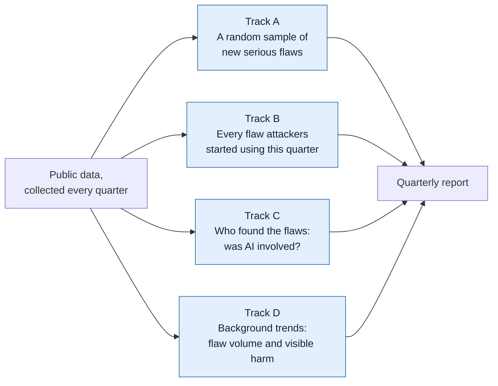
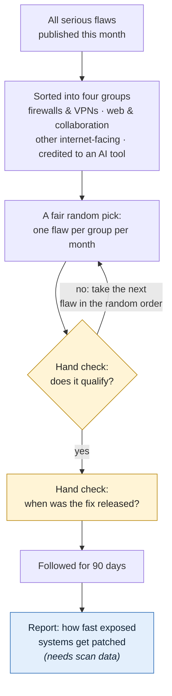
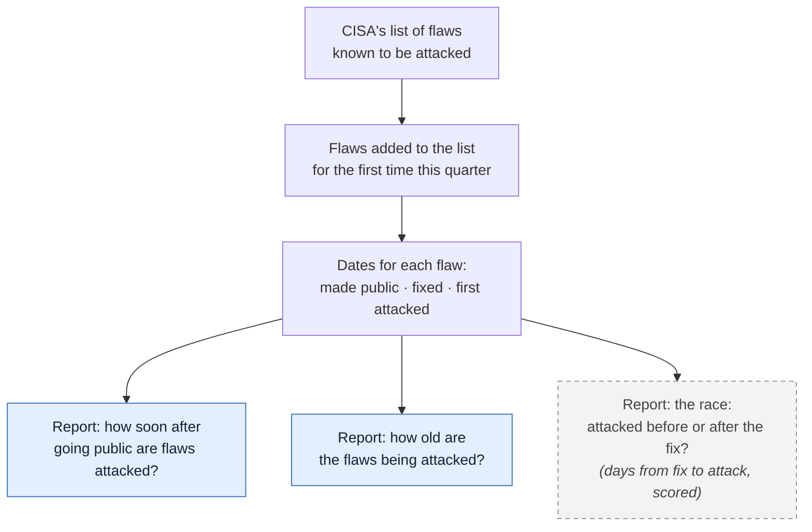
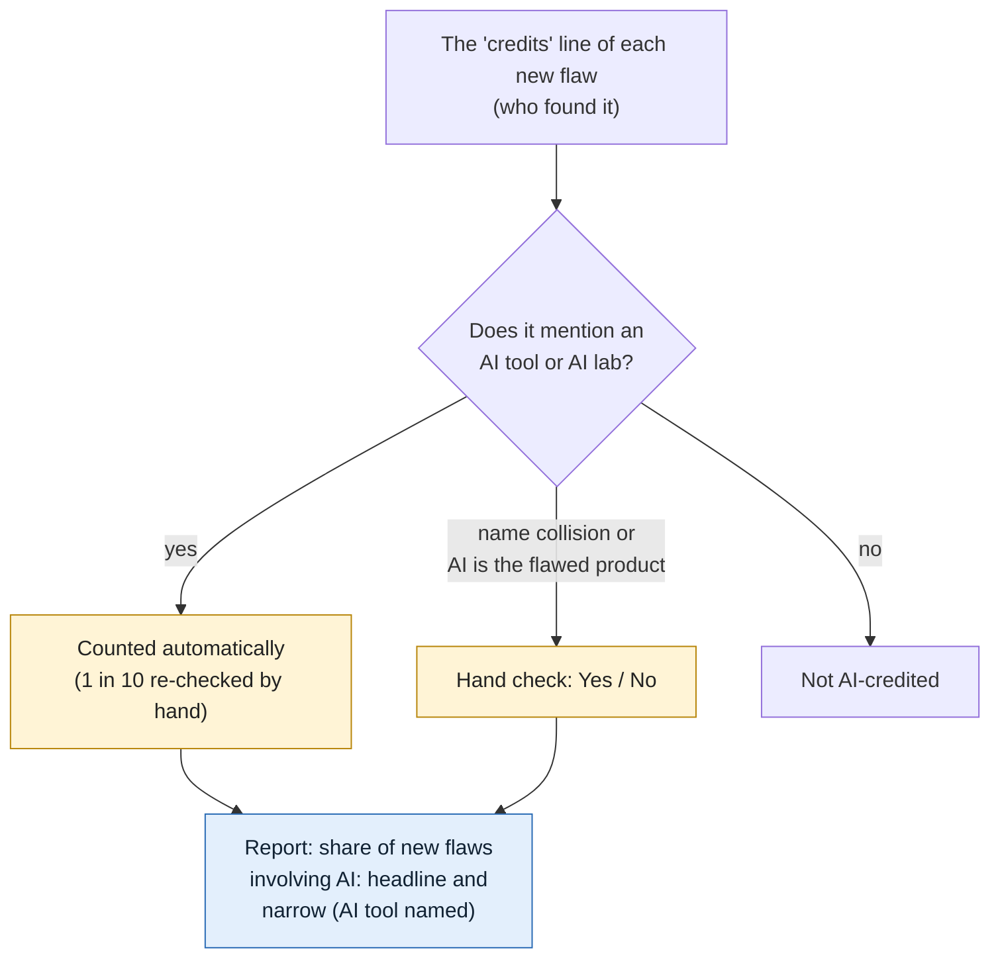
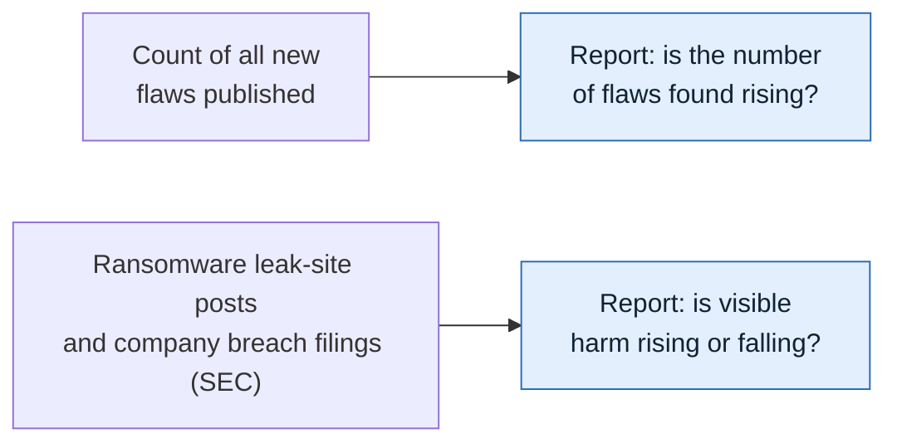
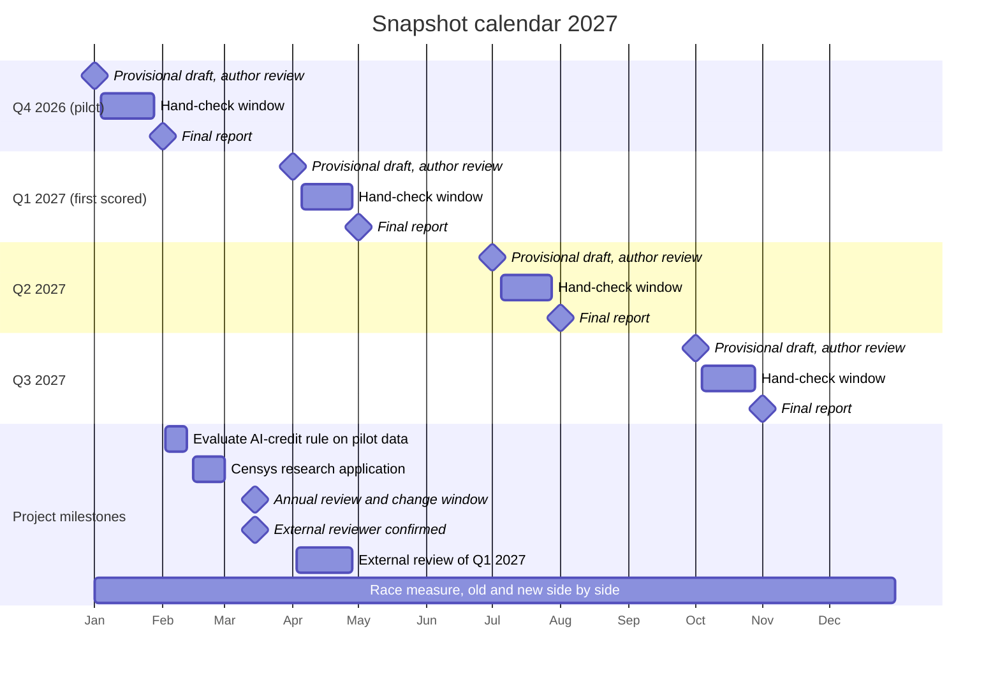
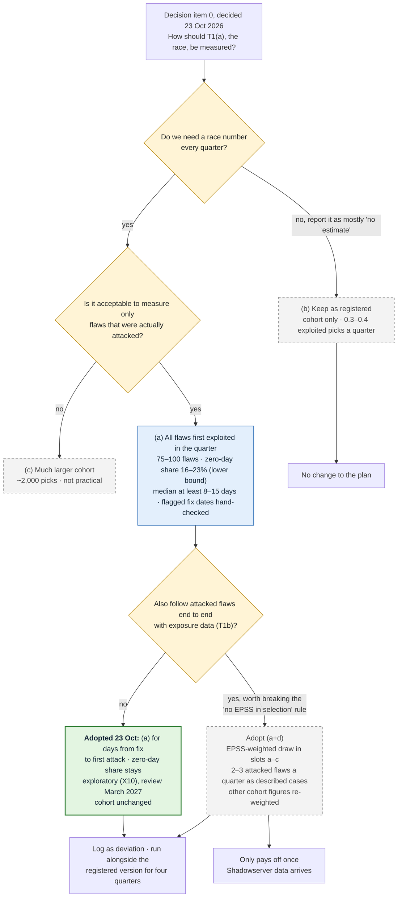

# How the quarterly report is built

Every quarter the study collects public data about software flaws and answers a small set
of questions about them. The work runs on four separate tracks. This page explains each
track in plain terms: what goes in, what is checked by hand, and what the report says.

In the diagrams, **yellow boxes** are checks done by hand by the author, **blue boxes** are
findings that appear in the report, and **dashed grey boxes** are findings that cannot be
reported yet or are still being decided.

**Words used on this page**
- **Flaw:** a security weakness in a piece of software that has been given a public ID
  (a "CVE" number).
- **Serious:** rated 8 or higher out of 10 for severity, or rated "critical" by the vendor.
- **Fix:** the update from the software maker that closes the flaw.
- **Attacked:** there is public evidence that criminals or other attackers have used the flaw.
  The main source is CISA (the US Cybersecurity and Infrastructure Security Agency), which
  keeps a list of flaws known to be attacked.
- **Zero-day:** a flaw attacked before any fix existed.

## Overview: four tracks

| Track | Question the report answers | Status |
|---|---|---|
| A | Once a fix exists, how fast do exposed systems on the internet get updated? | Waiting for internet scan data |
| B | How soon are flaws attacked, how old are they, and is the fix usually out first? | Reported now (race measure decided 23 Oct 2026) |
| C | How often are flaws found with the help of AI tools? | Reported now |
| D | Is the number of flaws found rising, and is visible harm rising or falling? | Reported now |

## How the data flows

Each quarter an automatic job on GitHub pulls the data from free public sources, freezes an
exact copy (so every number can be recomputed later), checks it, and applies the rules for
picking flaws. The author's hand checks are added, Claude drafts the analysis, and the
author approves it before anything is published.

**Sources still awaiting permission** (dashed boxes) are shown as placeholders. Requests went
out on 20 October 2026, follow-ups are due on 20 November, and replies are hoped for by
1 January 2027, before the first (pilot) report. A source that says no is dropped and the
change is logged publicly; until a source says yes, nothing derived from it is published.

## Track A: a fair sample of new serious flaws

**What happens.** Each month, every newly published serious flaw is sorted into one of four
groups: firewalls and VPNs; web and collaboration software; other software reachable from the
internet; and flaws whose finders credit an AI tool. One flaw per group is then picked by a
fixed random draw that anyone can repeat, so nobody chooses which flaws are studied. That
gives up to 12 flaws a quarter.

**What is checked by hand.** Whether the pick really qualifies (for the "other" group: can it
be reached from the internet? for the AI group: did an AI tool really take part?). If not, the
next flaw in the random order is used. Then the date the fix was released is confirmed from
the software maker's own announcement.

**What the report will say.** For each flaw, how quickly the number of vulnerable systems
visible on the internet fell after the fix. This needs internet scan data, which has been
requested (Shadowserver); until it arrives, the report lists the sample and its fix dates only.

## Track B: every flaw attackers started using this quarter

**What happens.** No sampling here: every flaw added for the first time to CISA's list of
attacked flaws during the quarter is included, typically 75 to 100. For each, three dates
are recorded: when the flaw was made public, when the fix came out, and when the first attack
was recorded.

**What the report will say.**
- **How soon after going public are flaws attacked?** The typical number of days, and the
  share attacked on or before the day the flaw was made public.
- **How old are the flaws being attacked?** The share of attacks on flaws more than a year old.
- **The race (scored):** how many days the fix was out before the first attack, across every
  newly attacked flaw (adopted 23 Oct 2026; reported next to the registered version for four
  quarters).
- **Attacked before any fix existed (exploratory):** the zero-day share, reported every
  quarter but not yet scored, because one quarter's figure moves by about 7 points either way.
  It can be promoted at a March review once a year of data shows it is steady. Because CISA
  lists a flaw only once there is guidance for fixing it, it is a minimum: the true share is
  likely higher.

## Track C: was AI involved in finding the flaw?

**What happens.** Most flaw records include a credits line naming who found the flaw. Any
line that mentions an AI tool or a frontier AI lab is counted automatically (people credited
from an AI company are taken to be using AI); one in ten of those is re-checked by hand to
catch name collisions such as a person named Claude. Edge cases, such as an AI product that
is itself the thing with the flaw, are decided by hand.

**What the report will say.** The share of the quarter's new flaws whose credits involve AI,
as two numbers: the headline (any mention of an AI tool or AI lab) and the low end (an AI
tool named in a clear role, as registered). Q3 2026 test data: 0.81% and 0.43%. A trend is
called only when both move the same way.

## Track D: background trends

**What happens.** Two simple counts, compared with the same months a year earlier: the number
of new flaws published, and two signs of real-world harm: posts on ransomware groups' leak
sites (counts only, no victim names; published only once ransomware.live confirms) and the breach reports US public companies must file with
the SEC.

**What the report will say.** Whether flaw discovery is rising, and whether visible harm is
rising or falling.

## How the rules can change

The study is built so its results can be trusted from one quarter to the next. Its core (the
seven questions, the rules for picking flaws, the list of AI-tool terms and the root-cause
groups) was registered publicly in advance and is locked: an automatic check stops any quiet
change, and only the core decides whether a trend is called Improving, Worsening, Rising or
Falling. New ideas can still be explored at any time, but they appear in a separate,
clearly labelled "Exploratory" section and never affect those labels. The core changes only
to fix an error or a measure that has stopped working, and then in the open: the old and new
versions are reported side by side for four quarters, the switch happens only at the March
annual review, and every change is logged with its date, recorded on the public registration
(OSF) and marked with a new version tag. All raw data is kept, so a question added later can
usually be answered for earlier quarters too. Full details: `docs/CHANGE_POLICY.md`.

## Calendar for 2027

| Date | What happens |
|---|---|
| Fri 1 Jan | Q4 2026 (pilot quarter) data pulled automatically; provisional draft reviewed by the author and published within two days, labelled **pilot** |
| 4–28 Jan | Hand-check window for Q4 2026 (about 1½ hours of work, or about 50 minutes if race fix dates are sampled, at any time in the window; answers due by the 28th) |
| Mon 1 Feb | Q4 2026 final report (data pulled again, hand-check results included) |
| 2–12 Feb | Evaluation of the AI-credit rule on the pilot data: headline (any AI tool or lab mentioned) against the narrow count (AI tool named), a sample of lab-affiliated credits, and spot-check results; outcome goes to the 15 March review |
| 15 Feb – 1 Mar | Application for Censys research access (internet scan data), written by the author |
| Mon 15 Mar | Annual review and change window: the only time the core rules may change; changes logged on OSF. External reviewer confirmed by this date |
| Thu 1 Apr | Q1 2027 provisional report: the **first scored quarter**, the first with Improving / Worsening labels |
| 5–28 Apr | Hand-check window for Q1 2027 |
| 3–28 Apr | External review of the Q1 2027 provisional report (the first scored quarter), before the final report |
| Sat 1 May | Q1 2027 final report |
| Thu 1 Jul | Q2 2027 provisional report |
| 5–28 Jul | Hand-check window for Q2 2027 |
| Sun 1 Aug | Q2 2027 final report |
| Fri 1 Oct | Q3 2027 provisional report |
| 4–28 Oct | Hand-check window for Q3 2027 |
| Mon 1 Nov | Q3 2027 final report |
| All year | The new race measure (days from fix to first attack, all newly attacked flaws) is reported side by side with the registered version for four quarters |
| *Next:* Sat 1 Jan 2028 | Q4 2027 provisional report; first annual check against better reference data follows in March 2028 |

Data is pulled at 06:00 UTC (1 or 2 a.m. US Eastern) on the dates shown; reports are
built from that pull. Each report is a draft until the author has reviewed it (within two days for a provisional report). A provisional report uses the automatic figures; the hand-checked
figures (cohort fix dates, unclear AI credits) appear in the final report a month later.

## For the author: decision on the race measure (decided 23 Oct 2026)

Figures from `proposals/T1_OPTIONS.md` (Q2 and Q3 2026 back-test, corrected 2026-10-23 to
include older flaws).

## Keeping this page current

The diagrams are drawn by hand. `docs/diagrams/sources.json` lists the files each one depends
on; when one of those changes, the Checks workflow shows a yellow "Diagram may be out of date"
warning until the diagram is reviewed and re-stamped with
`python -m snapshot.diagrams stamp <name>`. Edit only the `.mmd` files: the Diagrams workflow
redraws the PNG copies automatically.
