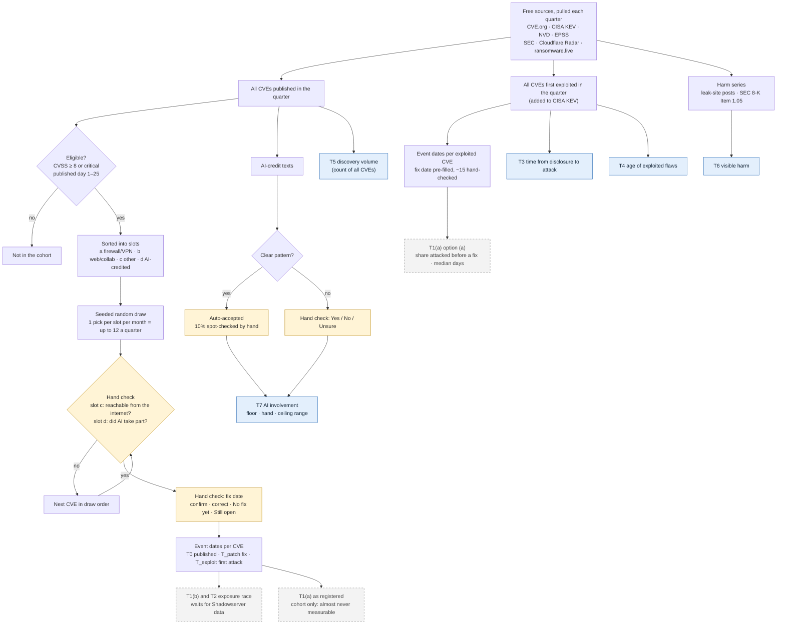
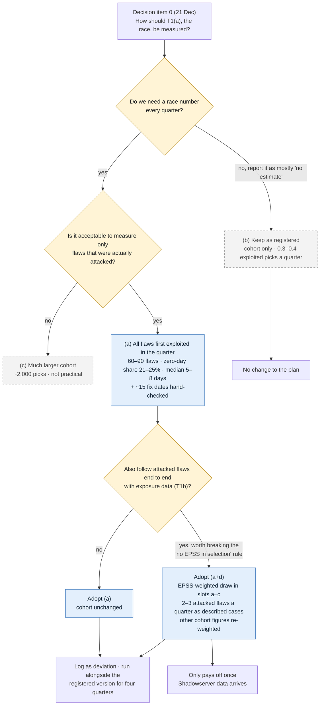

# Evaluation flow and the T1 decision

Two diagrams. GitHub draws them from the Mermaid source below; PNG copies are in
`docs/diagrams/` for slides and the landing page. Yellow boxes are hand checks (Hand Check
app), blue boxes are the reported measures, dashed grey boxes are not yet measurable or
still to be decided.

## 1. How a flaw moves through the study each quarter

Notes
- The cohort (left) feeds T1(b) and T2 once exposure data arrives, plus the root-cause and
  AI-vs-human comparisons. Its fix dates are the hand-checked T_patch.
- The exploited set (right) needs no draw: every CVE first added to CISA KEV in the quarter.
  It feeds T3 and T4 today, and T1(a) if option (a) is adopted (decision item 0).
- AI-credit texts (middle) feed T7; clear patterns are auto-accepted with a 10% spot check
  (`config/ai_credit_auto_accept.yaml`).

## 2. Decision item 0: how to measure T1(a), the race (21 Dec)

Figures from `proposals/T1_OPTIONS.md` (Q2 and Q3 2026 back-test).
