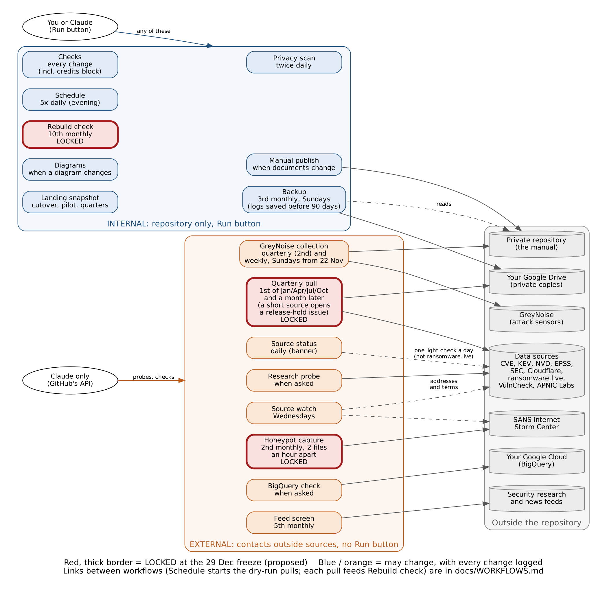
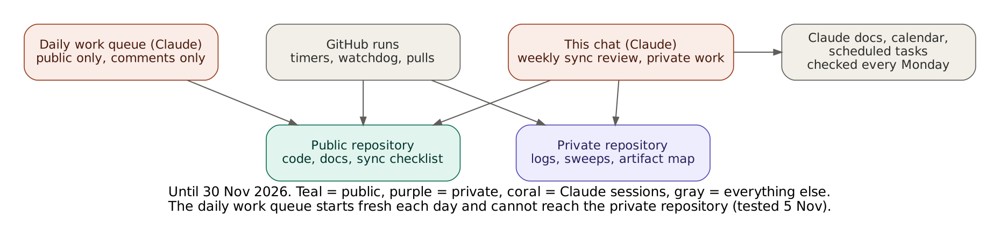
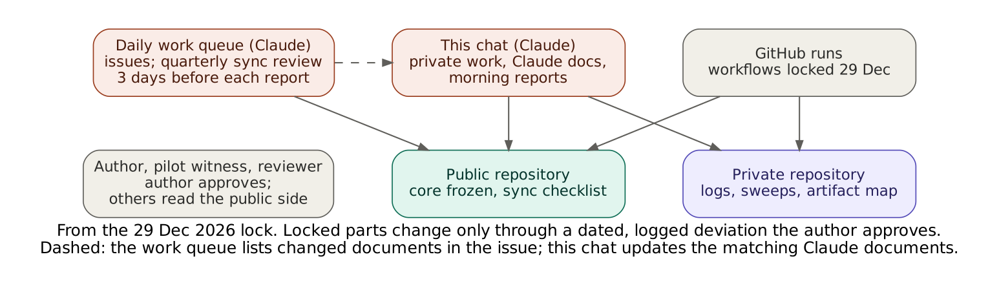

# Standard operating procedure: running workflows by hand (updated 17 Nov 2026)

**Status:** draft, written 29 Oct 2026 at the author's request. Reviewed by the author with the
workflow lock list on <!-- date:workflows-review -->20 Dec 2026<!-- /date -->; adopted at the 8 Feb 2027 pilot session; **in force from
9 Feb 2027**, after the Q4 2026 pilot. Until then the pilot rules apply (dry runs on 1 and
<!-- date:dry-run-full -->15 Dec<!-- /date -->, freeze on <!-- date:freeze -->29 Dec<!-- /date -->), and this draft may be used as guidance.

**Applies to:** the author and Claude. **Background:** `docs/WORKFLOWS.md` (what each workflow
does, how they depend on each other, and how critical each is).

## 1. Purpose

The study's workflows run themselves on timers. Running one by hand is sometimes useful (to
recheck, to recover from a skipped run, to make an extra backup) but must never disturb a
quarterly pull, change what the study measures, or put load on an outside source. This
procedure says which workflows may be run by hand, when that is a good idea, when it is
allowed, and when not to.

## 2. The two kinds of workflow

**Run button (author or Claude, any time the rules below allow):** Checks, Privacy scan,
Schedule, Rebuild check, Diagrams, Backup, Manual publish. They work inside the repository or with the author's own Drive. The
Run box opens with a sentence saying what the workflow does.

**API only, no button (Claude only, and only when asked or scheduled):** Quarterly pull,
Research probe, Honeypot capture, BigQuery check, Feed screen, Source watch. They contact outside sources, so a stray
click must never start them. See section 5.

### The workflows at a glance

*Blue: internal, repository only, with a Run button. Orange: external, no Run button, started
on a timer or by Claude through GitHub's API. Red with a thick border: proposed to be locked at
the <!-- date:freeze -->29 Dec 2026<!-- /date --> freeze (decision item 22), so they cannot change while the study runs; all
others may change, with every change logged. Source: `docs/diagrams/workflow_runs.dot`.*

## 3. Quiet periods: when no workflow is run by hand

1. **Pull days.** The 1st of January, February, April, May, July, August, October and
   November, from 06:00 to 10:00 UTC (01:00 to 06:00 ET), while a quarterly pull runs. Wait until
   its run shows a green check or a red cross.
2. **While any quarterly pull is running**, at any time (including a dry run or a re-run).
3. **While a `privacy` issue is open.** Fix the leak first; then run Checks, then the rest.
4. **During a freeze or decision session** (for example <!-- date:freeze -->29 Dec 2026<!-- /date -->), unless the session asks
   for a run.

## 4. The six Run-button workflows

### Checks
- **Does:** runs every test, including the guard on the locked study plan; changes nothing.
- **Run it when:** a Checks run failed and the cause may have been GitHub itself (run once
  more); before a decision session, to confirm main is healthy; after a Dependabot alert, to
  see whether anything breaks.
- **Allowed:** any time outside the quiet periods. It is read-only.
- **Do not:** re-run a failed Checks run over and over to get a green result. If it fails
  twice, read the log and tell Claude; a real failure must be fixed, not retried.

### Privacy scan
- **Does:** scans every file on main and run-reports for keys, tokens, personal details and
  figures not yet cleared; opens a `privacy` issue if anything turns up. Changes nothing else.
- **Run it when:** after anything personal or secret may have been pasted into the repository
  (an email, a key, a phone number); after a privacy issue was fixed, to confirm it is clean
  before closing the issue; before a report or the website is published.
- **Allowed:** any time, including during the quiet periods (it only reads).
- **Do not:** close a `privacy` issue until a fresh scan comes back clean.

### Schedule
- **Does:** opens the GitHub issues due today; on 1 and 15 Dec it also
  starts the dry runs.
- **Run it when:** by 09:00 ET no issues for the day have appeared, or the Actions list shows no
  Schedule run that day; after the schedule was changed, with **dry run** ticked, to preview.
- **Allowed:** any time outside the quiet periods. It never opens an issue twice.
- **Do not:** set the "pretend today is" date to a future day without ticking **dry run** (it
  would open future issues early). On 1 and 15 Dec a manual run also starts that day's dry-run
  pull, just as the timer would; it is never started twice.

### Rebuild check
- **Does:** recomputes a frozen quarterly bundle from scratch and confirms the figures match.
- **Run it when:** after each final pull, once its run is green (it also runs by itself on the
  10th); before any report is published; after any change to the pinned software (Python,
  packages, container), to confirm old figures still reproduce.
- **Allowed:** outside the quiet periods, when a bundle exists (bundles are kept 90 days on
  GitHub; an older one must first be restored from Drive, which Claude does).
- **Do not:** treat a mismatch as something to re-run away. A mismatch is a finding: record it
  in the session log and stop publishing until Claude explains it.

### Diagrams
- **Does:** redraws the diagram pictures for comparison; changes nothing.
- **Run it when:** a diagram changed and its automatic run failed, or you want to compare the
  pictures.
- **Allowed:** any time outside the quiet periods.

### Backup
- **Does:** copies the whole repository, with history, to the Drive folder
  Internet-Security-Snapshot-2027, saves The Snapshot manual (Markdown) under
  `manual/`, and writes a small file proving the connection works.
- **Run it when:** after the manual changes and you want the Drive copy current; after a decision session or freeze; before a report is published; after the
  Drive connection was renewed; before any risky repository change.
- **Allowed:** outside the quiet periods; at most once a day (each run is a full copy and
  uses Drive space).
- **Do not:** run it while a pull is running (both write to Drive).

### Manual publish
- **Does:** rebuilds The Snapshot and copies it to your private repository snapshot-manual
  (only you can see it). Changes nothing here.
- **Run it when:** the private copy looks out of date, or after the token was renewed.
- **Allowed:** any time; it also runs by itself after every document change.

## 5. The six API-only workflows

These are started only by Claude, and only when the author asked in chat or the schedule says
so. Each manual start is recorded in that day's session log with the reason.

| Workflow | When a manual start is acceptable | Never |
|---|---|---|
| Quarterly pull | Dry runs (1 and 15 Dec 2026); re-running a failed official pull, with the author's yes, the same day, once (the author can also do this with the Re-run button, section 7) | More than one re-run per quarter without a written reason; any change to its sources or settings after the <!-- date:freeze -->29 Dec<!-- /date --> freeze except by the change policy |
| Research probe | Testing a new or changed source the author asked about | More than once a day per source; any probe that scans hosts or collects personal data |
| Honeypot capture | Its monthly run was missed | More than once a month (to keep the load on SANS low) |
| BigQuery check | After a change to the Google Cloud setup; before the HTTP Archive work | Queries above the 10 MB cap; anything outside the free tier |
| Feed screen | Its monthly run failed or was missed; a feed list change needs testing | More than once a week |
| Source watch | Its weekly run failed or was missed; after an address in `config/source_watch.yaml` was fixed | More than once a day; on a pull day |

Standing limits that always apply: ransomware.live is never polled more often than every 30
minutes; no scanning or host-level data; no keys in chat.

## 6. Before and after any manual run

1. **Check** the quiet periods (section 3) and the Actions list: is anything already running?
2. **Run** it, choosing `main` as the branch.
3. **Watch** for the result (most finish within 2 minutes; a pull takes longer).
4. **Record** a one-line note in the day's session log: what was run, why, by whom, and the
   result. Claude does this when told.
5. **If it fails:** run it once more only if the log points to GitHub itself (a timeout or
   "runner" error). Otherwise leave it red and tell Claude; never delete the run (its log is
   evidence).

## 7. If Claude is unavailable

Added 29 Oct 2026 (author's question: what if the Claude account limit is reached?). The study
does not depend on Claude to keep collecting data.

1. **Everything essential runs on GitHub's timers:** Quarterly pull, Rebuild check, Backup,
   Honeypot capture, Privacy scan and Schedule. The December dry runs are started by Schedule.
2. **The watchdog covers missed timers.** Every Schedule run checks that the quarterly pull
   (1st of Jan/Feb/Apr/May/Jul/Aug/Oct/Nov), honeypot capture (2nd), backup (3rd) and rebuild
   check (10th) actually ran. If one has not started 10 hours after its time, it starts it itself,
   only once, and opens a **watchdog** issue telling you. Check that run's result, then close the
   issue. Since 1 Nov 2026 it also restarts the daily Source status check behind the
   landing-page banner, quietly (no issue). GitHub starts scheduled runs late at busy times
   (measured 28 Oct - 5 Nov 2026: morning UTC timers 6 to 8 hours late, evening ones about 4,
   none dropped), so the wait was raised from 4 to 10 hours on 5 Nov 2026 and the daily timers
   moved to the evening (trial reviewed 12 Nov). Late is not missing: do not start a run by hand
   because it has not appeared by morning.
3. **If a run failed, rerun it yourself with GitHub's Re-run button.** This works for every
   workflow, including those without a Run button, and repeats the run with exactly the same
   settings:
   1. Open the **Actions** tab and click the failed run (red cross).
   2. At the top right, click **Re-run jobs**, then **Re-run all jobs**, and confirm.
   3. Wait for the result. Rerun a failed quarterly pull once only, on the same day; if it fails
      again, leave it red and note it in the session log for Claude to investigate later.
4. **What waits for Claude:** research probes, the BigQuery check, fixes to failing code, and
   the reports. None of these stops the data collection.

### When a new Claude chat takes over: one primary chat

Added 11 Nov 2026 (author's request); rewritten 16 Nov 2026 when the author chose the
one-primary-chat design. Only one chat in the Claude project "AI Internet Security 2027 Research
Project" is the **primary**: it runs the morning report, the sync reviews and the chat-bound
reminders. Every other chat is **read-only** until the author promotes it. Three things make this
work without anyone remembering it:

- **The project's custom instructions** (Project settings, Instructions) hold how the author
  works, his standing rules and the one-primary rule. Every chat in the project reads them before
  its first reply. Source text: `PROJECT_INSTRUCTIONS.md` at the root of the private repository.
- **The primary-chat note** names the primary: `PRIMARY_CHAT.md` at the root of the private
  repository, and the project doc `claude/PRIMARY-CHAT.md`.
- **START HERE: NEW CHAT** (`START_HERE_NEW_CHAT.md`, private root; project copy
  `claude/START-HERE-NEW-CHAT.md`) is the short reference: setup, reading order, where things
  stand, and the scheduled tasks a new primary recreates.

**Which kind of chat (author, 16 Nov 2026).** Only a **Claude Code session** (started at
claude.ai/code, attached to the project) has a workspace and the GitHub tools needed to clone the
repositories, run the checks, push and keep the session logs; the primary chat is one. An
ordinary Claude chat started from the project page can read the project docs, calendar and mail
and say what is due (from `claude/WHATS-DUE.md`), but cannot reach GitHub, so it can never be the
primary. A takeover (C) must therefore start a Claude Code session; the handover test (B) checks
both kinds.

**A. One-time setup (author, 16 Nov 2026).**
1. Open the Claude project, open its settings, and paste the text of `PROJECT_INSTRUCTIONS.md`
   into the custom-instructions box. Save.
2. Check the project lists `claude/PRIMARY-CHAT.md` and `claude/START-HERE-NEW-CHAT.md`.

**B. Handover test (author; first test Tue 24 Nov 2026, after the 23 Nov cutover).**
1. Open a new chat **from the project page** (a chat started with the general "New chat" button
   is outside the project and never sees the instructions or project docs; found 16 Nov 2026). Do
   not tell it to take over.
2. Ask only: *"What's due next?"*
3. A pass: its first line says it is read-only; it gives what is due from the project doc
   `claude/WHATS-DUE.md` (a chat on claude.ai cannot reach GitHub; the primary refreshes that doc
   each morning); its list matches the study calendar; it changes nothing (no
   pushes, documents, mail drafts, calendar entries or scheduled tasks).
4. Then start a **Claude Code session** attached to the project and write: *"Handover test,
   read-only. Attach both repositories with read access, set them up as in START HERE section 1,
   run the checks, and tell me the results and what is due. Do not push, edit, write anything or
   touch scheduled tasks."* A pass: it reaches both repositories, the private one included (a
   fresh scheduled session could not on 5 Nov 2026), and the checks come back clean.
5. Tell the primary chat what both said. The primary fixes any gap in the instructions or in
   START HERE. Close the test chats, or keep them as read-only helpers.

**C. Promoting a new chat (when the primary is lost, full or broken).**
1. Start a **Claude Code session** attached to the project and write: *"You are now primary. Read
   claude/START-HERE-NEW-CHAT.md and take over."*
2. The new chat attaches and sets up both repositories and runs the checks (START HERE,
   section 1). If a check fails, it reports that first.
3. It updates the primary-chat note in both places (date, which chat, who promoted it).
4. It lists the scheduled tasks (`list_triggers`), pauses the old primary's chat-bound tasks
   (those tied to the old chat's session), and recreates them for itself from START HERE,
   section 6. The daily work queue is not tied to a chat and is left alone.
5. It reads the latest session logs and open issues, then tells the author in one message that it
   is the primary and what is due next.
6. If the old chat comes back, it is now read-only: the instructions and the note say so.

**D. If the project instructions are lost or changed by mistake.** Paste
`PROJECT_INSTRUCTIONS.md` back in. Any change to the instructions is made in that file first, then
pasted, so the two never differ.

**What never changes with the chat.** The GitHub timers, the watchdog, the study calendar feed
(built from `docs/schedule/schedule.yaml`) and the daily work queue keep running whichever chat
is primary. From the 23 Nov 2026 cutover the work queue does only the `owner:claude` issues not
labelled `primary-chat`; the morning report, sync reviews and every labelled task stay with the
primary chat. `docs/HANDOVER.md` (the
24 Oct handover from the first session) is read for its repository rules only, never as the
starting point. Keeping START HERE and the note current is part of every sync review
(`docs/SYNC_REVIEW.md`).

## 8. Who keeps everything in step (sync flow)

Added 5 Nov 2026 (author's request). Two Claude sessions work on the study, with different reach:

- **The primary chat** (section 7; named in `PRIMARY_CHAT.md`) can read and write both repositories. It does the private work
  (the AI-attack log, the tool sweeps, session logs, morning reports) and keeps the Claude
  documents in step with their repository copies, using the private artifact map
  (`exploratory/docs/artifacts/README.md`).
- **The daily work queue** is a scheduled Claude task that starts fresh each morning with the
  public repository only; a test on 5 Nov 2026 confirmed it cannot attach the private one. Until
  <!-- date:cutover -->23 Nov 2026<!-- /date --> it only comments on issues. From the cutover it works only the owner:claude issues
  without the label `primary-chat` (those it can finish from the public repository alone); the
  morning report, the sync reviews and every labelled task stay with the primary chat (author,
  16 Nov 2026). When a document with a Claude copy changes, it lists the documents in the issue
  and the primary chat updates the copies.

Until <!-- date:cutover -->23 Nov 2026<!-- /date -->:

From the <!-- date:freeze -->29 Dec 2026<!-- /date --> lock (core freeze and workflow lock), through the pilot (<!-- date:pull-provisional@1 -->1 Jan 2027<!-- /date -->) and
after the procedures are adopted (<!-- date:sop-adopt -->8 Feb 2027<!-- /date -->):

*After the lock, locked parts change only through a dated, logged deviation that the author
approves (`docs/CHANGE_POLICY.md`); neither Claude session can change them quietly. The pilot
witness and the independent reviewer see only the public side, plus what the author chooses to
show them. Sources: `docs/diagrams/sync_flow_now.dot`, `docs/diagrams/sync_flow_locked.dot`.*

## 9. Changes to this procedure

Changes after 9 Feb 2027 follow `docs/CHANGE_POLICY.md` for support material: written here with
the date and reason, noted in the session log, and raised at the next review.

## 10. API keys: what each one needs

Added 17 Nov 2026 (author's request). Every key lives only as a GitHub secret (repository
Settings, Secrets and variables, Actions). Never paste or read out a key, in chat, a file or an
email. Claude cannot see the values or the expiry dates; the author looks them up on each
service's own page. The private key register (risk R10) holds the dates, and every expiry gets a
reminder 30 days ahead in the schedule. Keys are checked at least once a year, and whenever a run
fails with an "unauthorised" or "forbidden" error. To replace a key: make the new one on the
service's page, paste it straight into the GitHub secret of the same name (Update secret), tell
Claude, and let the next scheduled run confirm it. Only the author handles keys.

**ransomware.live (`RANSOMWARE_LIVE_KEY`).** Used by: the quarterly pull. Managed at: the
ransomware.live portal (the green "Get your free API Key" button on the API page; sign-in by a
one-time link emailed to the address the account was made with, 20 Oct 2026). Expiry: none
stated (checked 17 Nov 2026). Limits: 60 requests a minute, 500,000 a month; the study's own rule
is never more often than every 30 minutes. If it stops working: the pull records a ransomware.live
gap. To renew: make a new key in the portal.

**NVD (`NVD_API_KEY`).** Used by: the quarterly pull. Managed at: no account page; a key is
requested on NVD's "Request an API Key" page and shown once through a one-time link emailed to
the requester, which must be opened within seven days. Expiry: none stated. Trap: requesting
another key with the same email deactivates the old one, so request one only to replace it, and
update the secret the same day. Limits: 50 requests in 30 seconds with a key (5 without). If it
stops working: the pull slows to the keyless rate.

**VulnCheck (`VULNCHECK_TOKEN`).** Used by: the quarterly pull (from the 1 Dec 2026 dry run), and a
keep-alive request on the 1st-2nd and 15th-16th of each month in the daily Source status run.
Managed at: the author's vulncheck.com account, API tokens page (status and last use). Expiry:
VulnCheck expires any token not used for 30 days; the keep-alive (author's decision, 17 Nov 2026)
stops that. If it stops working: the keep-alive step turns the Source status run red, and the pull
records a VulnCheck gap. To renew: make a new token on the tokens page.

**Cloudflare Radar (`CLOUDFLARE_TOKEN`).** Used by: the quarterly pull and research tasks. Managed
at: the Cloudflare dashboard, My Profile, API Tokens. Scope: Account, Radar, Read only; no IP
filter. Expiry: Cloudflare tokens do not expire unless a time limit is set; ours has none
(20 Oct 2026). To renew: the token's menu, Roll, which replaces it with the same permissions.

**OpenRouter (`OPENROUTER_API_KEY`).** Used by: the research task `openrouter_probe` only.
Managed at: openrouter.ai, Keys. Expiry: 12 May 2027 (author, 17 Nov 2026); renewal reminder
12 Apr 2027. Spending limit 0 and no credit bought, so it cannot spend money.

**Private-repository token (`MANUAL_REPO_TOKEN`).** Used by: Manual publish, Backup, Research,
Honeypot capture and Feed screen. A GitHub fine-grained personal access token with Contents read
and write on `pagagne/snapshot-manual` only. Managed at: GitHub, Settings, Developer settings,
Personal access tokens, Fine-grained tokens, where its expiry date is shown. If it stops working:
those five workflows fail (the private manual, backups and private sweeps stop). To renew:
Regenerate the token with the same settings, update the secret, then press Run on Manual publish
once (section 4).

**Google Drive sign-in (`RCLONE_CONF`).** Used by: Backup, the quarterly pull and research tasks.
An rclone configuration holding a Google sign-in for the author's Drive. Expiry: no date. It stops
working only if its access is removed in the Google Account's third-party connections, if it is
unused for six months (the monthly backup prevents that), or if the Google Cloud app it signs in
through is put in "Testing" (then seven days). To renew: make a new rclone configuration for the
same Drive and replace the secret (Claude has the steps).

**SEC contact (`SEC_USER_AGENT`).** Used by: the quarterly pull and Source status. Not a key: the
name and contact address the SEC requires on every request. No expiry; change it only if the
contact address changes.

**No stored key:** BigQuery (Google Cloud) signs in through Workload Identity Federation, a pass
that lasts one run, so nothing expires; `GITHUB_TOKEN` is made by GitHub for each run.

**GreyNoise (`GREYNOISE_API_KEY`).** Used by: the research task `greynoise_probe` (exploratory
X28), later its collector. Research Community Access granted 17 Nov 2026 (credit "Data provided by
GreyNoise"; 90 days of history; unlimited lookups) on the workspace of the study's project address;
key made 17 Nov 2026. Managed at: GreyNoise, the workspace menu, API Key. Expiry: none shown on
that page (author, 17 Nov 2026), so "none stated"; Martin's grant also names no end date. If it stops working: the probe or collector records a GreyNoise gap; nothing
else depends on it. To renew: make a new key there.

**Pending:** a CrowdSec or Shadowserver key, if granted, is added here and to the key
register the same day, with its expiry and limits.
