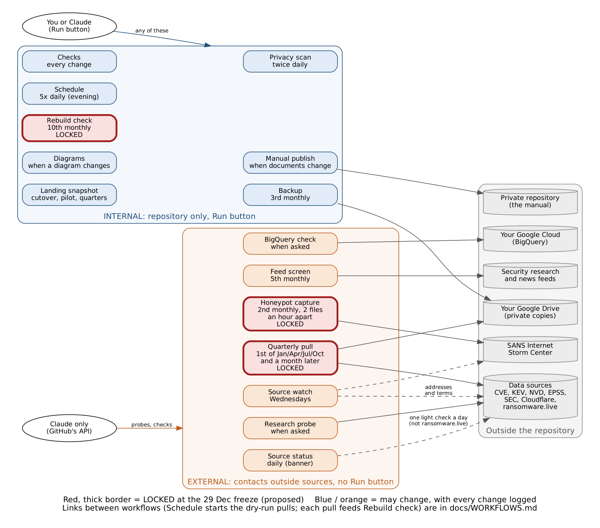
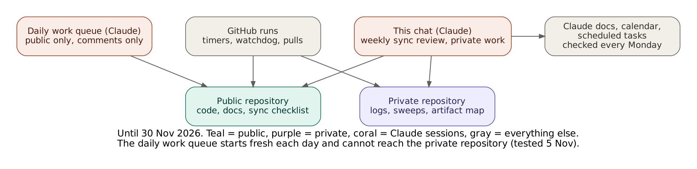
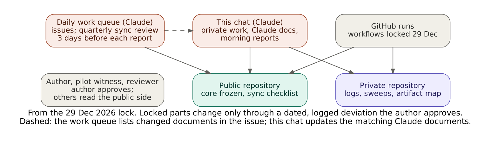

# Standard operating procedure: running workflows by hand (updated 11 Nov 2026)

**Status:** draft, written 29 Oct 2026 at the author's request. Reviewed by the author with the
workflow lock list on 18 Dec 2026; adopted at the 8 Feb 2027 pilot session; **in force from
9 Feb 2027**, after the Q4 2026 pilot. Until then the pilot rules apply (dry runs on 1 and
15 Dec, freeze on 29 Dec), and this draft may be used as guidance.

**Applies to:** the author and Claude. **Background:** `docs/WORKFLOWS.md` (what each workflow
does, how they depend on each other, and how critical each is).

## 1. Purpose

The study's workflows run themselves on timers. Running one by hand is sometimes useful (to
recheck, to recover from a skipped run, to make an extra backup) but must never disturb a
quarterly pull, change what the study measures, or put load on an outside source. This
procedure says which workflows may be run by hand, when that is a good idea, when it is
allowed, and when not to.

## 2. The two kinds of workflow

**Run button (author or Claude, any time the rules below allow):** Checks, Privacy scan,
Schedule, Rebuild check, Diagrams, Backup, Manual publish. They work inside the repository or with the author's own Drive. The
Run box opens with a sentence saying what the workflow does.

**API only, no button (Claude only, and only when asked or scheduled):** Quarterly pull,
Research probe, Honeypot capture, BigQuery check, Feed screen, Source watch. They contact outside sources, so a stray
click must never start them. See section 5.

### The workflows at a glance

*Blue: internal, repository only, with a Run button. Orange: external, no Run button, started
on a timer or by Claude through GitHub's API. Red with a thick border: proposed to be locked at
the 29 Dec 2026 freeze (decision item 22), so they cannot change while the study runs; all
others may change, with every change logged. Source: `docs/diagrams/workflow_runs.dot`.*

## 3. Quiet periods: when no workflow is run by hand

1. **Pull days.** The 1st of January, February, April, May, July, August, October and
   November, from 06:00 to 10:00 UTC (01:00 to 06:00 ET), while a quarterly pull runs. Wait until
   its run shows a green check or a red cross.
2. **While any quarterly pull is running**, at any time (including a dry run or a re-run).
3. **While a `privacy` issue is open.** Fix the leak first; then run Checks, then the rest.
4. **During a freeze or decision session** (for example 29 Dec 2026), unless the session asks
   for a run.

## 4. The six Run-button workflows

### Checks
- **Does:** runs every test, including the guard on the locked study plan; changes nothing.
- **Run it when:** a Checks run failed and the cause may have been GitHub itself (run once
  more); before a decision session, to confirm main is healthy; after a Dependabot alert, to
  see whether anything breaks.
- **Allowed:** any time outside the quiet periods. It is read-only.
- **Do not:** re-run a failed Checks run over and over to get a green result. If it fails
  twice, read the log and tell Claude; a real failure must be fixed, not retried.

### Privacy scan
- **Does:** scans every file on main and run-reports for keys, tokens, personal details and
  figures not yet cleared; opens a `privacy` issue if anything turns up. Changes nothing else.
- **Run it when:** after anything personal or secret may have been pasted into the repository
  (an email, a key, a phone number); after a privacy issue was fixed, to confirm it is clean
  before closing the issue; before a report or the website is published.
- **Allowed:** any time, including during the quiet periods (it only reads).
- **Do not:** close a `privacy` issue until a fresh scan comes back clean.

### Schedule
- **Does:** opens the GitHub issues due today; on 1 and 15 Dec it also
  starts the dry runs.
- **Run it when:** by 09:00 ET no issues for the day have appeared, or the Actions list shows no
  Schedule run that day; after the schedule was changed, with **dry run** ticked, to preview.
- **Allowed:** any time outside the quiet periods. It never opens an issue twice.
- **Do not:** set the "pretend today is" date to a future day without ticking **dry run** (it
  would open future issues early). On 1 and 15 Dec a manual run also starts that day's dry-run
  pull, just as the timer would; it is never started twice.

### Rebuild check
- **Does:** recomputes a frozen quarterly bundle from scratch and confirms the figures match.
- **Run it when:** after each final pull, once its run is green (it also runs by itself on the
  10th); before any report is published; after any change to the pinned software (Python,
  packages, container), to confirm old figures still reproduce.
- **Allowed:** outside the quiet periods, when a bundle exists (bundles are kept 90 days on
  GitHub; an older one must first be restored from Drive, which Claude does).
- **Do not:** treat a mismatch as something to re-run away. A mismatch is a finding: record it
  in the session log and stop publishing until Claude explains it.

### Diagrams
- **Does:** redraws the diagram pictures for comparison; changes nothing.
- **Run it when:** a diagram changed and its automatic run failed, or you want to compare the
  pictures.
- **Allowed:** any time outside the quiet periods.

### Backup
- **Does:** copies the whole repository, with history, to the Drive folder
  Internet-Security-Snapshot-2027, saves The Snapshot manual (Markdown) under
  `manual/`, and writes a small file proving the connection works.
- **Run it when:** after the manual changes and you want the Drive copy current; after a decision session or freeze; before a report is published; after the
  Drive connection was renewed; before any risky repository change.
- **Allowed:** outside the quiet periods; at most once a day (each run is a full copy and
  uses Drive space).
- **Do not:** run it while a pull is running (both write to Drive).

### Manual publish
- **Does:** rebuilds The Snapshot and copies it to your private repository snapshot-manual
  (only you can see it). Changes nothing here.
- **Run it when:** the private copy looks out of date, or after the token was renewed.
- **Allowed:** any time; it also runs by itself after every document change.

## 5. The six API-only workflows

These are started only by Claude, and only when the author asked in chat or the schedule says
so. Each manual start is recorded in that day's session log with the reason.

| Workflow | When a manual start is acceptable | Never |
|---|---|---|
| Quarterly pull | Dry runs (1 and 15 Dec 2026); re-running a failed official pull, with the author's yes, the same day, once (the author can also do this with the Re-run button, section 7) | More than one re-run per quarter without a written reason; any change to its sources or settings after the 29 Dec freeze except by the change policy |
| Research probe | Testing a new or changed source the author asked about | More than once a day per source; any probe that scans hosts or collects personal data |
| Honeypot capture | Its monthly run was missed | More than once a month (to keep the load on SANS low) |
| BigQuery check | After a change to the Google Cloud setup; before the HTTP Archive work | Queries above the 10 MB cap; anything outside the free tier |
| Feed screen | Its monthly run failed or was missed; a feed list change needs testing | More than once a week |
| Source watch | Its weekly run failed or was missed; after an address in `config/source_watch.yaml` was fixed | More than once a day; on a pull day |

Standing limits that always apply: ransomware.live is never polled more often than every 30
minutes; no scanning or host-level data; no keys in chat.

## 6. Before and after any manual run

1. **Check** the quiet periods (section 3) and the Actions list: is anything already running?
2. **Run** it, choosing `main` as the branch.
3. **Watch** for the result (most finish within 2 minutes; a pull takes longer).
4. **Record** a one-line note in the day's session log: what was run, why, by whom, and the
   result. Claude does this when told.
5. **If it fails:** run it once more only if the log points to GitHub itself (a timeout or
   "runner" error). Otherwise leave it red and tell Claude; never delete the run (its log is
   evidence).

## 7. If Claude is unavailable

Added 29 Oct 2026 (author's question: what if the Claude account limit is reached?). The study
does not depend on Claude to keep collecting data.

1. **Everything essential runs on GitHub's timers:** Quarterly pull, Rebuild check, Backup,
   Honeypot capture, Privacy scan and Schedule. The December dry runs are started by Schedule.
2. **The watchdog covers missed timers.** Every Schedule run checks that the quarterly pull
   (1st of Jan/Feb/Apr/May/Jul/Aug/Oct/Nov), honeypot capture (2nd), backup (3rd) and rebuild
   check (10th) actually ran. If one has not started 10 hours after its time, it starts it itself,
   only once, and opens a **watchdog** issue telling you. Check that run's result, then close the
   issue. Since 1 Nov 2026 it also restarts the daily Source status check behind the
   landing-page banner, quietly (no issue). GitHub starts scheduled runs late at busy times
   (measured 28 Oct - 5 Nov 2026: morning UTC timers 6 to 8 hours late, evening ones about 4,
   none dropped), so the wait was raised from 4 to 10 hours on 5 Nov 2026 and the daily timers
   moved to the evening (trial reviewed 12 Nov). Late is not missing: do not start a run by hand
   because it has not appeared by morning.
3. **If a run failed, rerun it yourself with GitHub's Re-run button.** This works for every
   workflow, including those without a Run button, and repeats the run with exactly the same
   settings:
   1. Open the **Actions** tab and click the failed run (red cross).
   2. At the top right, click **Re-run jobs**, then **Re-run all jobs**, and confirm.
   3. Wait for the result. Rerun a failed quarterly pull once only, on the same day; if it fails
      again, leave it red and note it in the session log for Claude to investigate later.
4. **What waits for Claude:** research probes, the BigQuery check, fixes to failing code, and
   the reports. None of these stops the data collection.

### When a new Claude chat takes over

Added 11 Nov 2026 (author's request). If the working chat ends, fills up or stops responding,
the author opens a new chat in the Claude project "AI Internet Security 2027 Research Project".

1. **The author's first message** tells the new chat to read **START HERE: NEW CHAT** first.
   That is the file `START_HERE_NEW_CHAT.md` at the root of the private repository
   `pagagne/snapshot-manual`; a copy is in the project as `claude/START-HERE-NEW-CHAT.md`, so the
   chat can read it before it has attached any repository. A first message that works:
   *"You are taking over the Internet Security Snapshot. Read claude/START-HERE-NEW-CHAT.md and
   follow it."*
2. **The new chat follows that file:** it attaches and sets up both repositories, reads the
   documents in the order listed there, recreates the chat-tied scheduled tasks, and tells the
   author it is ready and what is due next.
3. **Not the handover.** `docs/HANDOVER.md` is the 24 Oct handover from the first session. It
   is read for its repository rules, after START HERE, never as the starting point.
4. **Nothing on GitHub needs to change.** The timers, the watchdog and the daily work queue keep
   running across the change of chat (`docs/OPERATIONS.md`, "How a Claude session picks up
   work").
5. **Keeping START HERE current** is part of every weekly sync review (`docs/SYNC_REVIEW.md`);
   after each change the project copy is re-uploaded.

## 8. Who keeps everything in step (sync flow)

Added 5 Nov 2026 (author's request). Two Claude sessions work on the study, with different reach:

- **The original chat session** can read and write both repositories. It does the private work
  (the AI-attack log, the tool sweeps, session logs, morning reports) and keeps the Claude
  documents in step with their repository copies, using the private artifact map
  (`exploratory/docs/artifacts/README.md`).
- **The daily work queue** is a scheduled Claude task that starts fresh each morning with the
  public repository only; a test on 5 Nov 2026 confirmed it cannot attach the private one. Until
  30 Nov 2026 it only comments on issues. From the cutover it works the owner:claude issues and
  does the quarterly sync review from the public checklist (`docs/SYNC_REVIEW.md`). When a
  document with a Claude copy changes, it lists the documents in the issue and the chat session
  updates the copies.

Until 30 Nov 2026:

From the 29 Dec 2026 lock (core freeze and workflow lock), through the pilot (1 Jan 2027) and
after the procedures are adopted (8 Feb 2027):

*After the lock, locked parts change only through a dated, logged deviation that the author
approves (`docs/CHANGE_POLICY.md`); neither Claude session can change them quietly. The pilot
witness and the independent reviewer see only the public side, plus what the author chooses to
show them. Sources: `docs/diagrams/sync_flow_now.dot`, `docs/diagrams/sync_flow_locked.dot`.*

## 9. Changes to this procedure

Changes after 9 Feb 2027 follow `docs/CHANGE_POLICY.md` for support material: written here with
the date and reason, noted in the session log, and raised at the next review.
