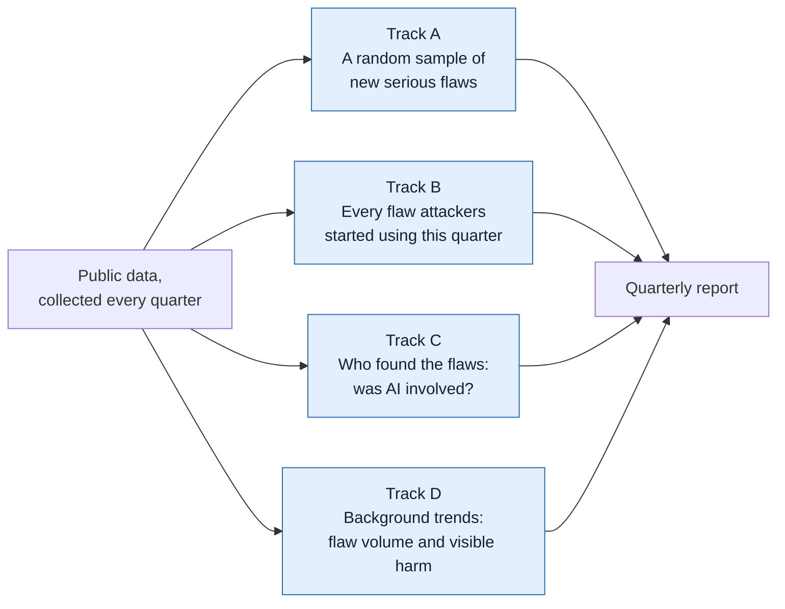
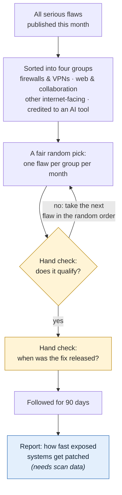
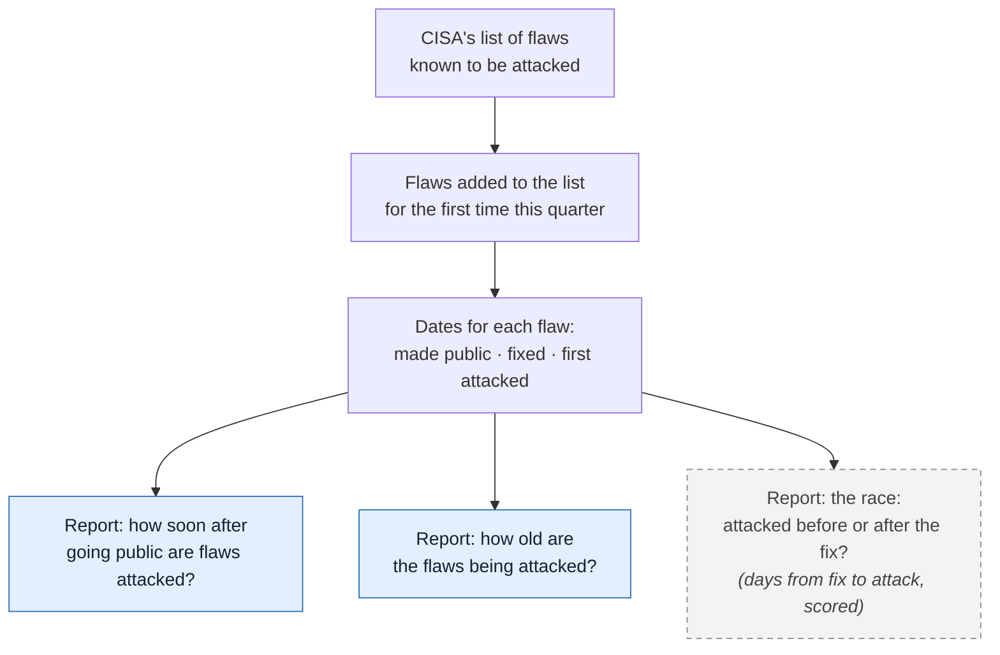
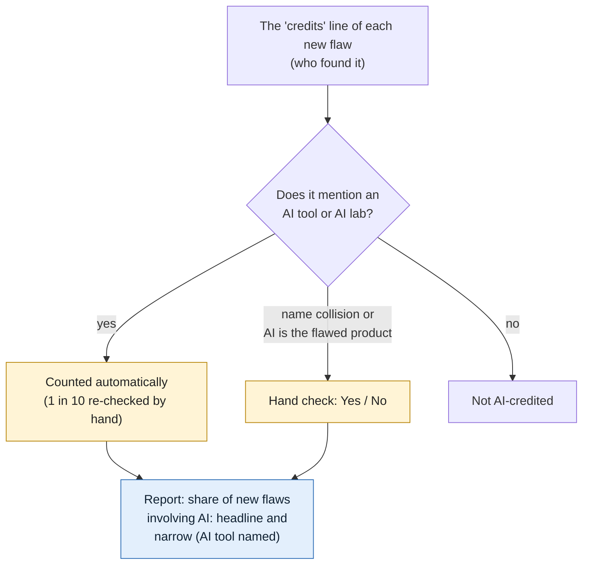
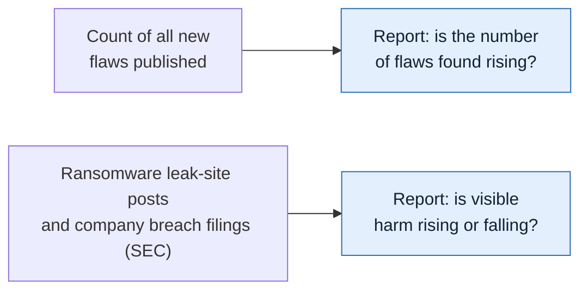
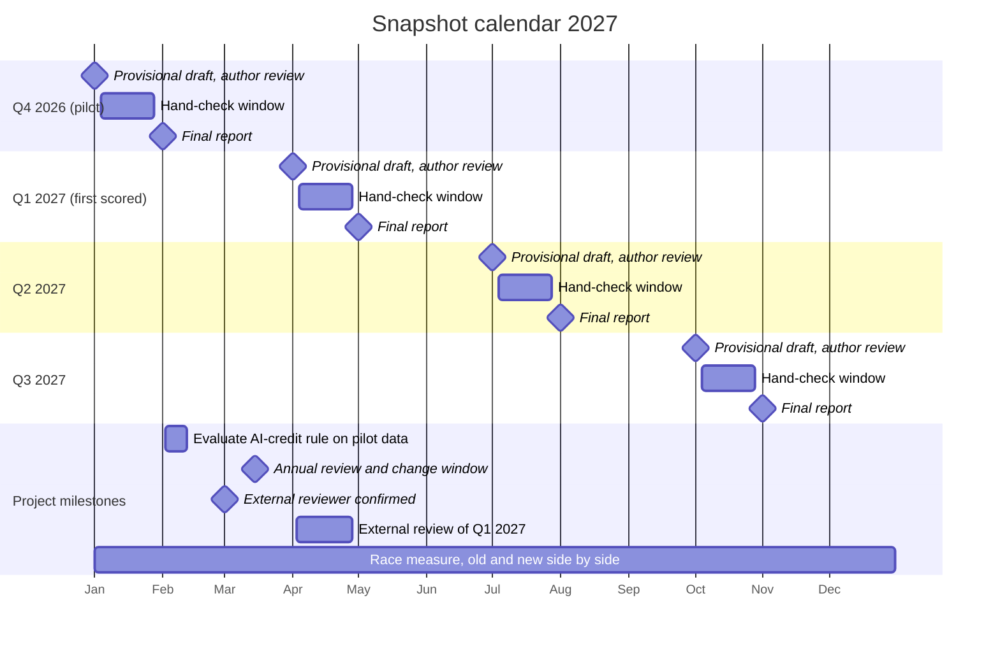
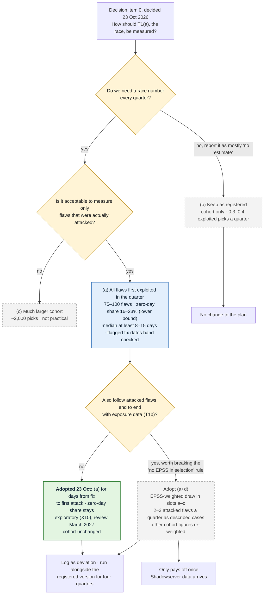
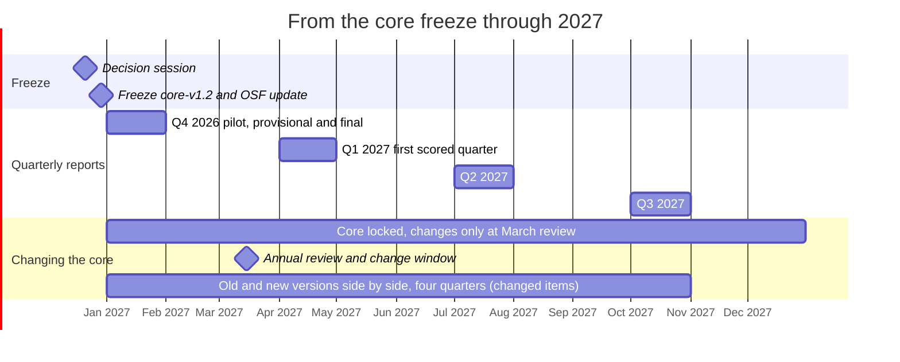

# Part II. Methods

[← Previous](01-part-i-the-study.md) · [Contents](../README.md) · [Next →](03-part-iii-the-ai-tool-explosion-attack-and-defenc.md)

*Part of [The Snapshot](../README.md), generated by `python -m snapshot.manual build`; do not edit.*

## How the quarterly report is built

*Source: [`docs/EVALUATION_FLOW.md`](https://github.com/pagagne/internet-security-snapshot/blob/main/docs/EVALUATION_FLOW.md)*

Every quarter the study collects public data about software flaws and answers a small set
of questions about them. The work runs on four separate tracks. This page explains each
track in plain terms: what goes in, what is checked by hand, and what the report says.

In the diagrams, **yellow boxes** are checks done by hand by the author, **blue boxes** are
findings that appear in the report, and **dashed grey boxes** are findings that cannot be
reported yet or are still being decided.

**Words used on this page**
- **Flaw:** a security weakness in a piece of software that has been given a public ID
  (a "CVE" number).
- **Serious:** rated 8 or higher out of 10 for severity, or rated "critical" by the vendor.
- **Fix:** the update from the software maker that closes the flaw.
- **Attacked:** there is public evidence that criminals or other attackers have used the flaw.
  The main source is CISA (the US Cybersecurity and Infrastructure Security Agency), which
  keeps a list of flaws known to be attacked.
- **Zero-day:** a flaw attacked before any fix existed.

#### Overview: four tracks

| Track | Question the report answers | Status |
|---|---|---|
| A | Once a fix exists, how fast do exposed systems on the internet get updated? | Waiting for internet scan data |
| B | How soon are flaws attacked, how old are they, and is the fix usually out first? | Reported now (race measure decided 23 Oct 2026) |
| C | How often are flaws found with the help of AI tools? | Reported now |
| D | Is the number of flaws found rising, and is visible harm rising or falling? | Reported now |

#### How the data flows

Each quarter an automatic job on GitHub pulls the data from free public sources, freezes an
exact copy (so every number can be recomputed later), checks it, and applies the rules for
picking flaws. The author's hand checks are added, Claude drafts the analysis, and the
author approves it before anything is published.

**Sources still awaiting permission** (dashed boxes) are shown as placeholders. Requests went
out on 20 October 2026, follow-ups are due on 20 November, and replies are hoped for by
1 January 2027, before the first (pilot) report. A source that says no is dropped and the
change is logged publicly; until a source says yes, nothing derived from it is published.

#### Track A: a fair sample of new serious flaws

**What happens.** Each month, every newly published serious flaw is sorted into one of four
groups: firewalls and VPNs; web and collaboration software; other software reachable from the
internet; and flaws whose finders credit an AI tool. One flaw per group is then picked by a
fixed random draw that anyone can repeat, so nobody chooses which flaws are studied. That
gives up to 12 flaws a quarter.

**What is checked by hand.** Whether the pick really qualifies (for the "other" group: can it
be reached from the internet? for the AI group: did an AI tool really take part?). If not, the
next flaw in the random order is used. Then the date the fix was released is confirmed from
the software maker's own announcement.

**What the report will say.** For each flaw, how quickly the number of vulnerable systems
visible on the internet fell after the fix. This needs internet scan data, which has been
requested (Shadowserver); until it arrives, the report lists the sample and its fix dates only.

#### Track B: every flaw attackers started using this quarter

**What happens.** No sampling here: every flaw added for the first time to CISA's list of
attacked flaws during the quarter is included, typically 75 to 100. For each, three dates
are recorded: when the flaw was made public, when the fix came out, and when the first attack
was recorded.

**What the report will say.**
- **How soon after going public are flaws attacked?** The typical number of days, and the
  share attacked on or before the day the flaw was made public.
- **How old are the flaws being attacked?** The share of attacks on flaws more than a year old.
- **The race (scored):** how many days the fix was out before the first attack, across every
  newly attacked flaw (adopted 23 Oct 2026; reported next to the registered version for four
  quarters).
- **Attacked before any fix existed (exploratory):** the zero-day share, reported every
  quarter but not yet scored, because one quarter's figure moves by about 7 points either way.
  It can be promoted at a March review once a year of data shows it is steady. Because CISA
  lists a flaw only once there is guidance for fixing it, it is a minimum: the true share is
  likely higher.

#### Track C: was AI involved in finding the flaw?

**What happens.** Most flaw records include a credits line naming who found the flaw. Any
line that mentions an AI tool or a frontier AI lab is counted automatically (people credited
from an AI company are taken to be using AI); one in ten of those is re-checked by hand to
catch name collisions such as a person named Claude. Edge cases, such as an AI product that
is itself the thing with the flaw, are decided by hand.

**What the report will say.** The share of the quarter's new flaws whose credits involve AI,
as two numbers: the headline (any mention of an AI tool or AI lab) and the low end (an AI
tool named in a clear role, as registered). Q3 2026 test data: 0.81% and 0.43%. A trend is
called only when both move the same way.

#### Track D: background trends

**What happens.** Two simple counts, compared with the same months a year earlier: the number
of new flaws published, and two signs of real-world harm: posts on ransomware groups' leak
sites (counts only, no victim names; published only once ransomware.live confirms) and the breach reports US public companies must file with
the SEC.

**What the report will say.** Whether flaw discovery is rising, and whether visible harm is
rising or falling.

#### How the rules can change

The study is built so its results can be trusted from one quarter to the next. Its core (the
seven questions, the rules for picking flaws, the list of AI-tool terms and the root-cause
groups) was registered publicly in advance and is locked: an automatic check stops any quiet
change, and only the core decides whether a trend is called Improving, Worsening, Rising or
Falling. New ideas can still be explored at any time, but they appear in a separate,
clearly labelled "Exploratory" section and never affect those labels. The core changes only
to fix an error or a measure that has stopped working, and then in the open: the old and new
versions are reported side by side for four quarters, the switch happens only at the March
annual review, and every change is logged with its date, recorded on the public registration
(OSF) and marked with a new version tag. All raw data is kept, so a question added later can
usually be answered for earlier quarters too. Full details: `docs/CHANGE_POLICY.md`.

#### Calendar for 2027

| Date | What happens |
|---|---|
| Fri 1 Jan | Q4 2026 (pilot quarter) data pulled automatically; provisional draft reviewed by the author and published within two days, labelled **pilot** |
| 4–28 Jan | Hand-check window for Q4 2026 (about 1½ hours of work, or about 50 minutes if race fix dates are sampled, at any time in the window; answers due by the 28th) |
| Mon 1 Feb | Q4 2026 final report (data pulled again, hand-check results included) |
| 2–12 Feb | Evaluation of the AI-credit rule on the pilot data: headline (any AI tool or lab mentioned) against the narrow count (AI tool named), a sample of lab-affiliated credits, and spot-check results; outcome goes to the 15 March review |
| Mon 1 Mar | External reviewer confirmed |
| Mon 15 Mar | Annual review and change window: the only time the core rules may change; changes logged on OSF |
| Thu 1 Apr | Q1 2027 provisional report: the **first scored quarter**, the first with Improving / Worsening labels |
| 4–28 Apr | Hand-check window for Q1 2027 |
| 3–28 Apr | External review of the Q1 2027 provisional report (the first scored quarter), before the final report |
| Sat 1 May | Q1 2027 final report, with the external review published beside it |
| Thu 1 Jul | Q2 2027 provisional report |
| 4–28 Jul | Hand-check window for Q2 2027 |
| Sun 1 Aug | Q2 2027 final report |
| Fri 1 Oct | Q3 2027 provisional report |
| 4–28 Oct | Hand-check window for Q3 2027 |
| Mon 1 Nov | Q3 2027 final report |
| All year | The new race measure (days from fix to first attack, all newly attacked flaws) is reported side by side with the registered version for four quarters |
| *Next:* Sat 1 Jan 2028 | Q4 2027 provisional report; first annual check against better reference data follows in March 2028 |

Every dated item, with who is responsible, is in `docs/ANNUAL_PLAN.md` (generated from
`docs/schedule/schedule.yaml`); if this table and the plan ever disagree, the plan is right.

Data is pulled at 06:00 UTC (1 or 2 a.m. US Eastern) on the dates shown; reports are
built from that pull. Each report is a draft until the author has reviewed it (within two days for a provisional report). A provisional report uses the automatic figures; the hand-checked
figures (cohort fix dates, unclear AI credits) appear in the final report a month later.

#### For the author: decision on the race measure (decided 23 Oct 2026)

Figures from `proposals/T1_OPTIONS.md` (Q2 and Q3 2026 back-test, corrected 2026-10-23 to
include older flaws).

#### Keeping this page current

The diagrams are drawn by hand. `docs/diagrams/sources.json` lists the files each one depends
on; when one of those changes, the Checks workflow shows a yellow "Diagram may be out of date"
warning until the diagram is reviewed and re-stamped with
`python -m snapshot.diagrams stamp <name>`. Edit only the `.mmd` files: the Diagrams workflow
redraws the PNG copies automatically.

## Hand-check procedure

*Source: [`docs/HAND_CHECK.md`](https://github.com/pagagne/internet-security-snapshot/blob/main/docs/HAND_CHECK.md)*

Some items are flagged by code but need a person to confirm them before they count.
Nothing unverified is ever estimated or filled in: an item that is not confirmed is left
out and reported as pending.

#### What is checked by hand

1. **AI-credit matches** (T7, cohort category d): CVEs whose credits contain a term from
   `config/ai_credit_terms.yaml`.
2. **Internet-facing status** for cohort CVEs in category (c), "any other product".
3. **Patch dates** (T_patch) for cohort CVEs, confirmed against the vendor's advisory.
4. **Ground-truth reference dates** for the validation cases (done once, before the run).
5. **HHS breach list download** (X17, since 29 Oct 2026): once a quarter, download the public
   CSV from the HHS OCR breach portal (ocrportal.hhs.gov/ocr/breach) and give it to Claude,
   who keeps only the quarterly counts.

#### How a review works each quarter

1. After the pull, the code writes `review/<quarter>.csv`: one row per item, with the
   evidence (exact credit text, product, vendor link) and a suggested decision.
2. Identical credit texts are grouped, so one decision covers every CVE that uses it.
3. Decisions already made in earlier quarters are applied automatically from
   `review/decisions.csv` and listed as "already decided".
4. The author marks each new row **yes** or **no**, with an optional note, in the Hand Check
   app (below).
5. Only rows marked yes are used. Unreviewed rows are excluded and reported as pending.
6. The review file, decisions, reviewer and date are published in the quarter's bundle.

#### The Hand Check app

Hand checks are done in a private web app (source: `apps/hand-check.html`; how to use it:
[`HAND_CHECK_APP.md`](#doc-docs-hand-check-app-md)), not in a spreadsheet. After each data run, Claude loads that quarter's review list into it. The app
shows one item at a time (AI credits and cohort picks as separate sections), saves every
answer as it is made, tracks time spent, and ends with a report.

How results flow into the study:
1. The author answers items in the app; answers are saved in the app's own database.
2. When the author says the list is done, Claude reads the answers and writes them to
   `review/decisions.csv` in this repository (one row per item: decision, fix date and its
   status, time, note), committed with a dated message. Earlier decisions carry over to
   later quarters automatically.
3. The evaluation uses only `review/decisions.csv`, so every hand decision behind a
   published number is public and reviewable.
4. A CSV copy can also be saved from the app's Report view as a personal backup.

#### How the hand check fits the random draw

Each month's pick in every slot comes from a seeded random draw (`config/cohort_rules.yaml`,
`selection`). The review file lists, for slots (c) and (d), the CVE at the top of the
draw order. Mark it yes or no:

- **Yes:** it is the month's pick for that slot.
- **No:** it is recorded as skipped with the reason, and the next CVE in draw order is
  added to the next review file. You never choose which CVE comes next; the draw does.
- A slot stays open until its pick is confirmed, so an unanswered item holds that slot
  (and only that slot) back.

#### What counts as AI involvement (author's rule, since 2026-10-23)

**Any mention of an AI tool or a frontier AI lab in the credits counts**, whatever the
wording: "using Codex", "found by Big Sleep", "Claude Opus 5", "in collaboration with Claude
and Anthropic Research", "Trail of Bits in collaboration with OpenAI", "Amy Burnett of
OpenAI", "Alex Matrosov with Claude, Anthropic". The reasoning: people credited from an AI
company can be taken to be using AI, and credits rarely say how a flaw was found, so
judging each wording adds work without adding information. These credits are counted
automatically (`config/ai_credit_auto_accept.yaml`, v1.3).

Still sent to the author:
- Name collisions: a person or handle that happens to match a term ("Claude Bernard",
  "Qwen (VulDB User)").
- Wording that makes the AI the subject of the flaw ("vulnerability in Claude", "prompt
  injection").
- Qihoo 360, a security company rather than an AI lab, whose credits usually name human
  researchers.

A random 10% of automatic yeses (at least three) still comes to the author as spot checks,
mainly to catch name collisions; a "no" on a spot check suspends the rule that accepted it
until it is reviewed.

**The narrower count is kept alongside.** Credits that name an AI *tool* in a clear role
("using", "found by", a model name with its version, "in collaboration with" a tool) are
also counted separately, with lab names ignored. This is the measure as registered, and it
is the low end of the T7 range (below). The gap between the two shows how much of the
headline rests on lab affiliation; for example, if AI labs hire more security researchers,
the headline rises even if AI use does not.

History: automatic yes for clear patterns adopted 22 Oct; "in collaboration with" removed
22 Oct after a practice spot check; restored and extended to labs 23 Oct; any mention of a
tool or lab 23 Oct. All logged in `prereg/DEVIATIONS.md`. The rule is re-evaluated on the
Q4 2026 pilot data in February 2027, before the 15 March review.

#### Criteria for the remaining hand decisions

The few credits that still reach the author are name collisions and edge cases. Count a
credit as AI involvement if it names an AI tool, model or agent, or a frontier AI lab, in
any role other than as the thing that had the flaw. Do **not** count:

- A person's name or handle that happens to match a term ("Claude Bernard", "Qwen (VulDB
  User)").
- Credits where the AI product is the subject of the flaw, with no sign an AI tool helped
  find it.
- Security companies that are not AI labs (Qihoo 360, Google Project Zero as a human team;
  its AI tool Big Sleep is matched separately).

When the text is genuinely unclear, the decision is **no**, with a note.

#### Two versions reported

T7 is reported each quarter under the registered term list (v1.0) and the current list,
with the current list labeled as a deviation. See `prereg/DEVIATIONS.md`.

#### T7 as a range

Credits often do not say how a flaw was found, so T7 is reported as a range each quarter
(`src/snapshot/t7.py`), with one denominator, all CVEs published in the quarter:

- **Low end (AI tool named):** credits naming an AI tool in a clear role, lab names
  ignored; the measure as registered; no judgment involved.
- **Headline (AI tool or lab mentioned):** any mention of an AI tool or frontier AI lab,
  plus any credits the author answered yes to.
- **Ceiling:** every credit mentioning any listed AI term; equals the headline except for
  name collisions and other credits the author rejected.

Q3 2026 (test data, rules of 23 Oct): low end 0.43%, headline 0.81% of 36,732 CVEs.
A direction is called only when the low end and the headline move the same way (two quarters
running against the median of the previous four); otherwise T7's direction is "unclear".
Borderline calls can move the hand-checked figure within the range but cannot create a
trend on their own. (Direction rule to be confirmed at the 21 December session.)

#### Consistency of hand decisions

Each quarter, 20 earlier author decisions are shown again, unmarked, among the new ones:
AI-credit texts, fix dates and slot (c) internet-facing calls, drawn by a seeded sample
(`snapshot.decisions.retest_items`). Fix-date items show the pre-fill the author saw the first
time, never the earlier answer. A re-shown answer is recorded with `retest=True` and never
replaces the original decision. Consistency is published per kind
(`snapshot.decisions.consistency_by_kind`): the same yes/no answer for credits and slot (c),
and for fix dates the same status with dates within one day. Each rate carries its one-sided
90% lower bound: if all 20 match, consistency is at least 89% (with 5 it was only 63%; five
items were used until 24 Oct 2026). About 8 extra minutes a quarter.

#### Second coder

Consistency cannot reveal a bias the author applies the same way every time; a second,
independent coder can. Each quarter, after the author's hand check, `snapshot.agreement`
draws 20 of the author's decisions (up to half from uncertain cases: marked unsure, fix date
corrected, unknown or "no fix yet", pre-fill assumed or flagged), writes them without the
author's answers for the second coder, and keeps the sampling weights in a separate file the
coder does not see. The coder answers in that file, or in the Hand Check app as a batch whose
metadata names them; their answers go to `review/second_coder.csv`, never to
`review/decisions.csv`. Reported: raw agreement, Cohen's kappa, Gwet's AC1 and agreement on
Yes and No for the yes/no checks, and the share of fix dates within one day with the median
difference, weighted back to the whole batch. Pooled over the year for the March review.
Nothing here decides a label. The second coder is lined up with the external reviewer
(decision item 17).

#### How to read T7: disclosed, not total

T7 counts flaws whose credits *say* an AI tool took part. It depends on the finder
choosing to disclose it. Discoveries made with hosted AI services are often credited
(the lab may share the credit), while discoveries made with models run privately on a
researcher's own machine, such as open-weight models, usually are not. As local models
improve, T7 can lag real AI use, or even fall while use rises. Every report states this
next to the T7 figures, and a change in T7 is described as a change in *disclosed* AI
involvement.

See `docs/EVALUATION_FLOW.md` for where each hand check feeds into the measures.

#### Time per quarter (estimate, 24 Oct 2026)

From the practice round (about 30-60 seconds per item) and the rules as of 24 Oct:

| Part | Items | Time |
|---|---|---|
| Approve the provisional draft (1st-3rd) | 1 | 20-30 min |
| AI credits: spot checks and edge cases | about 10-15 | 5-8 min |
| Cohort: fix dates and slot c checks | about 12 picks + 3-6 candidates | 15-20 min |
| Race: flagged fix dates of newly attacked flaws | about 60 (or a sample of about 15-20) | about 60 min (or 15-20 min) |
| Re-shown items (consistency) | 20 | about 8 min |
| HHS breach list download (X17) | 1 file | about 5 min |
| **Hand-check window total** | | **about 1½ hours, or about 50 minutes with a race sample** |
| Final-run check (2nd of the following month) | new rows only | 15-30 min |

Whether every flagged race fix date is checked or a sample is decided on 12 Nov 2026. The
same choice applies to the baseline year (four quarters of newly attacked flaws, roughly
200-250 flagged dates if all are checked), which the race labels compare against.

## Hand Check app: user guide

*Source: [`docs/HAND_CHECK_APP.md`](https://github.com/pagagne/internet-security-snapshot/blob/main/docs/HAND_CHECK_APP.md)*

The Hand Check app is where the author makes the study's hand decisions each quarter. It
replaces working through a spreadsheet. The criteria for each decision are in
[`HAND_CHECK.md`](#doc-docs-hand-check-md); this guide covers how to use the app.

- **Where:** a private page in the author's Claude account, named "Snapshot Hand Check"
  (claude.ai → Artifacts). Only the author can open it. It works on a phone or a computer.
- **Source code:** [`apps/hand-check.html`](https://github.com/pagagne/internet-security-snapshot/blob/main/apps/hand-check.html). This file is for
  reference only: downloaded and opened from a computer it cannot reach the review lists or
  save answers. Always open the app from claude.ai → Artifacts → Snapshot Hand Check.
- **When:** any time from the 4th to the 28th of the month after each provisional run (for example 4-28 Jan for Q4 2026), and the baseline-year sessions (23-24 Nov 2026). Answers given by the 28th are used in the final report on the 1st.
  Calendar entries carry the steps.

#### 1. Before you start

After a data run, Claude loads that quarter's review list into the app. Ask Claude in the
chat if the list you expect is missing. Pick the list from the **List** menu at the top.
Practice lists are labelled "not scored".

About 20 items in each quarterly list are earlier decisions shown again, unmarked, to measure
consistency (`docs/HAND_CHECK.md`). Answer them like any other item; they never change your
original answer. When loading a list, Claude keeps each review row's `retest` flag on the
item (not displayed). A second coder's list is loaded as its own batch with `coder` set in
the batch metadata, so their answers are recorded separately.

#### 2. The screen

- **Progress bar and counts** at the top: items done, done per section, time spent so far,
  and an estimate of time left based on your own pace.
- **Sections:** *AI credits*, *Cohort picks* and *Report*. Do them in any order; each
  saves on its own.

#### 3. AI credits

Since 23 October 2026, any mention of an AI tool or a frontier AI lab in a credit counts as
AI involvement and is accepted automatically (`HAND_CHECK.md`). Most quarters this section
will therefore be short: it holds only

- **spot checks** (marked): a random sample of automatic yeses, mainly to catch name
  collisions such as a person named Claude. Answer honestly: a "No" suspends the rule that
  accepted it;
- **edge cases**: credits where the AI product may be the thing that had the flaw, and
  credits naming Qihoo 360 (a security company, not an AI lab).

Question for each: does this credit name an AI tool or AI lab as taking part, rather than a
person who shares a name with a tool, or the product that had the flaw? Answer **Yes**,
**No** or **Not sure** (counts as no). Keys on a computer: `Y`, `N`, `U`.

Two ways to work, switch any time: **one at a time** (credit text, matched terms, flaws
covered, links to example CVE records) or **list by category** (all items on one screen,
Yes / No / ? on each row; **Mark unanswered as Yes/No** answers the rest of a group after
you confirm).

Everything accepted automatically is listed under **Accepted automatically** for reference.

Each distinct credit text appears once even if it covers many flaws, and decisions carry
over to later quarters, so later lists only ask about new credit texts.

#### 4. Cohort picks

The month's picks from the seeded random draw, one slot at a time.

- **Edge device and Web/collaboration slots:** only the fix date is needed.
- **Other product (slot c):** is the product reachable from the internet in normal use?
- **AI-credited (slot d):** does the credit say an AI tool took part?

For slots c and d, up to three candidates are listed in draw order. Answer **No** and the
app moves to the next candidate; answer **Yes** and the remaining candidates are skipped
and the app asks for the fix date. If all three are no, the slot stays empty.

**Fix date:** the pre-filled date, where it came from, and the advisory links.

- **Confirm date** (`C`) if the link shows the same date.
- **Correct it** (`E`) to pick the right date.
- **Can't find** if a fix exists but its date can't be established; add a note.
- **No fix yet** if the vendor has not released a fix (for example only workarounds, or
  "fix pending" for every version). The check date is recorded, and the flaw comes back for a fix date in later runs until one exists.
  An unfixed flaw is a real result for the race between fixing and exploitation.

Dates marked *assumed* came from the CVE publication date, not from an advisory: open the
link before confirming.

**Check online** links on every item: the CVE record (cve.org), the NVD page, a product
search, and the vendor's advisory or patch links from the CVE record. They open in a new
tab.

#### 5. Help me decide

On AI-credit cards and slot c/d candidates, **Help me decide** (in the list view, it opens
that credit in the one-at-a-time view) walks
through the rule as a few yes/no questions and ends with a suggested answer and the reason.
**Use this answer** records it; **Start over** resets. The questions are:

*AI credit:* (1) Does it name an AI tool or model, not just a company? (2) Is the AI only the
thing that had the flaw? If so, does it also say an AI tool helped find it? (3) Does it say
the tool took part in finding, testing or reporting it? (4) If still unclear: answer no.

*Internet-facing (slot c):* (1) Is it a server, appliance, web app or online service?
(2) Is it normally reached over the internet? (3) If meant to be internal, is it commonly
exposed anyway (from your own knowledge or the vendor's documentation)? Otherwise no.

#### 6. Notes, Back and Skip

- **Note:** optional. On a card, type it and tap **Save note** (it also saves when you click
  away). In the list view, tap **Add note** under a credit. Notes are kept even if you clear
  the answer, and appear in the Report.
- **Back:** returns to the previous item to change an answer.
- **Skip for now:** moves on and leaves the item open.
- **Clear my answer** (one at a time), or tap a highlighted answer again (list view):
  removes the answer so the item is open again.

Answers save the moment you tap. Close the page any time; it resumes where you left off,
on any device.

#### 7. Report and finishing

The **Report** tab shows AI credits counted, each slot's pick and fix date, dates corrected
or unknown, "not sure" answers, notes and total time. Tap any item to change it.
**Save answers as CSV** keeps a personal copy.

When everything is answered, tell Claude in the chat. Claude then:

1. reads the answers from the app;
2. writes them to `review/decisions.csv` in this repository (one row per item: decision,
   fix date and status, time spent, note), in a dated commit;
3. reruns the evaluation, which uses only `review/decisions.csv`.

Every hand decision behind a published number is therefore public and reviewable.

#### What the app does not decide

Which flaws qualify, which slot they fall in and which one is drawn are set by the frozen
rules before the list reaches you. The app records only the three judgments above.

## Change policy: locked core and add-on layer

*Source: [`docs/CHANGE_POLICY.md`](https://github.com/pagagne/internet-security-snapshot/blob/main/docs/CHANGE_POLICY.md)*

The study keeps a stable baseline while still learning new things by keeping two layers apart.

#### 1. Locked core (baseline `core-v1.1`)

The seven tracking questions, the cohort rule (`config/cohort_rules.yaml`), the AI-credit
term list (`config/ai_credit_terms.yaml`), the automatic-yes rules for clear-cut AI credits
(`config/ai_credit_auto_accept.yaml`) and the root-cause map
(`config/root_cause_map.yaml`), together with the frozen pre-registration. These are
computed the same way every quarter and alone decide the Improving/Worsening and
Rising/Falling labels.

The baseline includes the rule changes logged in `prereg/DEVIATIONS.md` on 20–21 October
2026 (AI-credit term list v1.1 and v1.2, the seeded random draw, plus two clarifications),
all made before any result or cohort existed. Git tag `core-v1.1` marks it.

**Until the core freeze (31 December 2026)** the core can still change, because no quarter
has been scored yet: each change is logged in `prereg/DEVIATIONS.md` on the day it is made
(for example the automatic yes for clear-cut AI credits and the T7 range, 22 October), and
the open questions are settled at the 21 December decision session
(`docs/CORE_FREEZE_DECISIONS.md`). The freeze tags `core-v1.2` and files an update on OSF.
From then on the rules in section 4 apply.

Checksums of the locked files are in `prereg/LOCKED.yaml`. `tests/test_locks.py` runs on
every push and fails if a locked file changes without its checksum and a dated deviation
row being updated, so no core change can happen quietly.

#### 2. Add-on (exploratory) layer

New measures, breakdowns and data sources go in `config/exploratory.yaml`, each with a
dated entry. They appear in a separate "Exploratory" section of the quarterly report, are
clearly labeled, and never decide a label or change the cohort (`feeds_labels: false`,
enforced by a test). They can be added at any time.

#### 3. Raw data is kept

Every quarterly pull freezes the full raw inputs with checksums. A question added later
can usually be answered for earlier quarters from those bundles, so starting late does not
lose history. Where a source only keeps aggregates (ransomware.live), only the aggregates
exist to go back to.

#### 4. Changing the core

A core change is made only when it fixes an error or a measure has stopped working. Then:

1. **Run both side by side.** Report the old and new versions together for four quarters
   (the length of the comparison window), as is already done for the AI-credit term list.
2. **Switch at the annual review.** Changes to the core, and promotion of an exploratory
   measure into the core, happen only at the March annual review.
3. **Log it.** Add a dated row to `prereg/DEVIATIONS.md`, update `prereg/LOCKED.yaml`,
   file an update on the OSF registration, and tag the new baseline (`core-v1.2`, …).

Bug fixes that change no rule (for example a parsing error) can be made at any time, but
are still logged as deviations if they change any published number.

#### 5. Tags

- `prereg-v1.0`: the registered plan.
- `core-v1.1`, `core-v1.2`, …: each locked baseline.
- `snapshot-<quarter>-<provisional|final>`: the exact code and config used for each
  quarterly run, created by the quarterly workflow. Tags are never moved or deleted.

#### 6. Run reports

Each quarterly or manual run saves its log, manifest and data quality report to the
`run-reports` branch (secret values scrubbed, no data bundle), so problems can be diagnosed
without signing in to GitHub. The data bundles themselves stay as run artifacts and are
archived on Zenodo with each final release.

#### 7. Sources that change during the year

Added 30 Oct 2026 (author's decision, after JPCERT/CC's terms page warned that its addresses may
change). Sources are watched every week by the Source watch workflow (`config/source_watch.yaml`:
every core and companion data address and every source's terms page), so a change is usually
found weeks before a pull needs it. Each change found is handled in one of three ways, written
in the session log the day it is handled and in `prereg/DEVIATIONS.md` once the core is frozen:

1. **Moved, same data.** The address changed but the data did not (same fields, same counting,
   same terms). Update the address in the collector and in `config/source_watch.yaml`, log the
   date with both addresses, and confirm the next dry run or pull reads it. The series carries
   on unchanged. This is a bug-fix-level change (section 4, last paragraph).
2. **Changed format, method or terms.** The source still exists but its fields, its counting
   or its terms changed (a new or renamed column, a new definition, a narrower licence). The
   figures from the first affected quarter onward are flagged **exploratory** in the quarterly
   report until the next review (September or March) decides, with the side-by-side comparison
   of section 4, whether the series is still comparable. A terms change that withdraws
   permission stops collection at once (`config/sources.yaml`), whatever the review date.
3. **Gone.** The source has stopped publishing or can no longer be reached for a whole pull
   window. The series is marked **broken** from that quarter, and every report says so plainly.
   No other source is ever put in its place under the same name (decision item 16, no
   substitutes); a replacement can only start as a new exploratory measure (section 2) and
   reach the core at a March review.

Terms pages are copied, dated, to `source-watch/terms/` on the run-reports branch and saved in
the Internet Archive whenever their wording changes, so the terms in force when the data was
used can always be shown.

## Core freeze: decisions before scoring starts

*Source: [`docs/CORE_FREEZE_DECISIONS.md`](https://github.com/pagagne/internet-security-snapshot/blob/main/docs/CORE_FREEZE_DECISIONS.md)*

The core (rules that decide the Improving/Worsening labels) must be final before the
Q4 2026 pilot is scored on 1-2 January 2027. After the freeze it changes only at a March
review (docs/CHANGE_POLICY.md). The exploratory layer stays open at all times.

- **Decision session:** 21 December 2026
- **Freeze:** by 31 December 2026 — tag `core-v1.2`, update `prereg/LOCKED.yaml`,
  log in `prereg/DEVIATIONS.md`, file an update on OSF.

After the freeze the core stays locked all year. The only change window is the annual
review on 15 March; any core item changed there (or on 21 Dec) is reported in old and new
form side by side for four quarters. The exploratory layer can change at any time.

Each item: decide **promote to core**, **keep exploratory**, or **drop**. Evidence comes
from the two December dry runs (1 Dec, and the full run with all available sources on 15 Dec)
and the test runs.

| # | Item | Now | Question for the session | Evidence to bring |
|---|---|---|---|---|
| 0 | **T1(a) cannot be estimated from the cohort** | Core · **decided 23 Oct 2026 (author):** option (a) for the days-from-fix-to-first-attack figure; zero-day share stays exploratory (item 7); cohort and EPSS rule unchanged; for the session: confirm and freeze | Test on Q3 2026: none of the 11 cohort picks reached CISA KEV within follow-up (fewer than 1% of serious CVEs are ever listed), so the registered T1(a) median (patch to exploit across cohort CVEs) is undefined almost every quarter. Options: (a) compute T1(a) on all CVEs first exploited in the quarter (about 100 KEV additions), with fix dates pre-filled automatically and a hand-checked sample; keep the cohort for exposure (T1b, T2) and description; (b) keep as registered and report it as mostly censored; (c) larger cohort; (d) weighted cohort (EPSS-weighted draw, back-tested 2026-10-22: 2-3 exploited picks per quarter but the race estimate stays far too uncertain; would break the EPSS rule); (a+d) combined. | `proposals/T1_OPTIONS.md` (Q3: 0.42% of eligible CVEs exploited; registered cohort averages 0.3-0.4 exploited picks per quarter; back-test table for Q2 and Q3 2026); diagram: `docs/EVALUATION_FLOW.md` §2 |
| 1 | Root-cause map coverage | Core | Adopt map v1.1 (`proposals/root_cause_map_v1.1.yaml`)? It cuts "other/unknown" from 29% to 14% of eligible CVEs (Q3 2026). NVD fill is already in the registered source order and will be implemented regardless (small effect: 11.6% to 10.7% with no CWE). | `proposals/ROOT_CAUSE_MAP.md` |
| 2 | T6(b) SEC Item 1.05 | Core | Keep as is, or add voluntary Item 8.01 cyber disclosures alongside? (Q3 2026, after the collector was fixed to search each form separately: 11 filings, 7 of them original reports) | Next run's SEC diagnostics |
| 3 | X6 Speed in the tail | Exploratory | Promote? It is tool-agnostic and catches faster attackers, incl. self-hosted models | Q3 2026 and baseline-year values |
| 4 | X7 Patch to public exploit code | Exploratory | Keep exploratory until a year of data shows it is stable? | Coverage of PoC-in-GitHub for cohort CVEs |
| 5 | X8 Breadth of exploitation | Exploratory | Promote or keep? | Quarter-to-quarter noise in baseline year |
| 6 | X9 Bug types exploited | Exploratory | Depends on item 1 | — |
| 7 | X10 Zero-day share | Exploratory · **decided 23 Oct 2026:** stays exploratory | Promotion candidate at the 15 March 2027 review, once a year of data shows it is steady (one quarter moves about 7 points either way) | Share of unknown fix dates |
| 8 | X3 AI-run campaign log (with its quarterly web sweep, 26 Oct), X5 AI software, X11, X12, X14-X22 | Exploratory | Stay exploratory (curated or context). X19-X22, the views beyond the US, are probed 27 Oct and decided at the 12 Nov review; the sweep's queries, languages and pages are fixed before the freeze | — |
| 9 | AI credit term list | Core (v1.2) | Promote any watchlist candidates seen in credits by December? | Watchlist scan from the dry run |
| 10 | Slot (a) keyword "gateway" | Core | Too broad: the Q3 preview put Jupyter Enterprise Gateway (a data-science server) in the edge-device slot. Match "gateway" only with VPN/remote-access/SSL/security words? | Edge-slot picks from the baseline preview |
| 11 | Internet-facing rule for slot (d) | Core | Does the internet-facing requirement apply to AI-credited picks too? The preview offered Firefox and FreeBSD. | Slot d candidates in the baseline |
| 12 | Automatic yes for AI credits | Core (adopted 2026-10-22; v1.3 on 23 Oct, author's decision: any mention of an AI tool or frontier AI lab counts as the headline; the registered tool-named count is kept alongside as the low end; re-evaluated on pilot data 2–12 Feb 2027 for the 15 March review) | Confirm, adjust patterns, or revert, in light of the spot checks so far | Spot-check answers; list of auto-accepted texts |
| 13 | Promote "Anthropic OSS program" to the AI term list (headline already counts it via the Anthropic lab name since 23 Oct; this item now concerns only the narrow count) | Watchlist | Credit names a program, not a tool, so it is a hand-check "no" today, yet the program is an AI scanner (Claude models) and the CVE records type it as finder. Promote as a tool name, or keep the strict wording rule? Also: promote other program/service names on the same basis? Same pattern seen in the practice hand check (22 Oct): "Amy Burnett (OpenAI Codex Security)" and "Zheng Yu (DepthFirst AI)" name an organization whose business is AI vulnerability-finding, as a person's affiliation, without saying the tool was used (answered no). Conflict of interest: Anthropic. | Count of CVEs credited to it by December; the program's public description |
| 14 | T7 direction rule | Proposed | Call T7 Rising/Falling only when floor and ceiling agree (two quarters running), else "unclear"? Keep the hand-checked figure as the headline number? | Floor/ceiling for the baseline year; first consistency rate |
| 15 | Programme-evidence T7 estimate | Proposed | Report a fourth T7 figure counting credits from organizations with a documented, dated AI-discovery programme (see `exploratory/credit_groups.md`)? Reported only; never decides direction. Promote any such organizations' names in the term list instead? | Q3 2026: about 133 of 139 unclear CVEs come from such organizations |
| 16 | **Sources still awaiting permission** (Shadowserver, VulnCheck; ransomware.live granted 27 Oct, publishing on) | Asked 20 Oct; follow-ups 20 Nov | Any source without a written yes by 21 Dec runs under Plan 2 (without it) for the Q4 2026 pilot, with nothing derived from it published; logged in `prereg/DEVIATIONS.md`. A yes that arrives later is switched on at the next quarter's run. The switches are in `config/sources.yaml` (permission, collect, publish), built 26 Oct | `docs/PERMISSIONS.md`, `docs/RESEARCH_PLAN.md` (Plan 1 / Plan 2) **Decided 29 Oct (author, indicator review):** no substitutes inside the registered indicators; without Shadowserver, I1 is hand-read or "not available", I4 uses its registered KEV version and I6 is "not available"; free sources appear only as exploratory companions (X23 beside I4, X24 beside I6). The registered plan is evaluated for justified changes after the pilot (schedule items `plan-evaluation`, 10 and 17 Feb 2027), for the 15 Mar 2027 review |
| 17 | **External reviewer** for the first scored quarter | Promised in the pre-registration. Since 24 Oct: invitation drafted (`docs/reviewer/INVITATION.md`), university postings planned (UGA first), reviewer tasks scheduled (`owner: reviewer` in `docs/schedule/schedule.yaml`), Reviewer's Desk built (`site/reviewer/`) | Who? Candidates (a security researcher, a statistician, a CVE/KEV practitioner). Scope as in the invitation: the Q1 2027 provisional report against the plan, a spot check of three randomly drawn headline figures from spreadsheet worksheets, a sample of hand decisions, and second coder each quarter; credit as named reviewer and Zenodo contributor. Confirm by 1 Mar 2027; review window 3-28 Apr 2027 | Shortlist of candidates |
| 18 | Anything else | — | Brainstorm: what would we regret not measuring by 2028? | Notes |
| 19 | **Companion check beside every label** | Proposed 24 Oct 2026 (reporting addition; the registered rule is unchanged) | Report beside each Improving/Worsening/Rising/Falling label whether a two-quarters-versus-prior-four test at the 10% level supports it, using each quarter's bootstrap standard error? Log it today so it cannot look chosen after results | Simulation: the registered rule labels pure noise in 48% of quarters (61% with autocorrelation); the check in 10% (14%). Code `src/snapshot/labels.py`; `docs/STATISTICAL_REVIEW_2026-10-24.md` point 5 |
| 20 | **Interval dates, X13 and hand-check reliability** | Proposed 24 Oct 2026 (exploratory and quality; no label effect) | Confirm: race fix dates stored as [fix_lo, fix_hi] and attack dates as exploit_hi, zero-day share reported as a range; X13 (whole-population AI-versus-other comparison, defined in `config/exploratory.yaml`); re-shown items raised from 5 to 20 a quarter and a blinded second coder on 20 items, reported as raw agreement, AC1, kappa and Yes/No agreement | `docs/STATISTICAL_REVIEW_2026-10-24.md` points 6, 7 and 9. **Added 26 Oct (author):** a hand-check note "patched early for selected parties (embargo)" with the private date where known, carried at the early end of the fix-date range; the headline keeps the public release date (`docs/cases/php2shell.md`) |
| 21 | **2027 closing re-run, 1 April 2028** | Proposed 24 Oct 2026 | Re-run all four 2027 quarters once every 2027 cohort flaw has its full 90-day follow-up (the final run on the 1st of the following month allows only about a month for each quarter's last month), published as a completeness addendum to the March 2028 annual check. Scored labels are not changed | Calendar event 1 Apr 2028; `docs/STATISTICAL_REVIEW_2026-10-24.md` |
| 22 | **Workflow lock** | Agreed 25 Oct 2026 (author): lock with the core on 29 Dec | Which GitHub workflows are locked and how they may change. Proposed: the data workflows (quarterly pull, rebuild check, the Dockerfile) are fingerprinted in `prereg/LOCKED.yaml` and change only at the March review or to fix a breakage, with a dated deviation row; the support workflows (Checks, Schedule, Diagrams, Research, Pages, Backup) may change with a change-log entry and passing Checks. Every workflow has a successful run since its last change before the lock | `docs/WORKFLOWS.md` (14 Dec), author review 18 Dec |
| 23 | **CISA "active exploitation" date as an attack date** | Proposed 27 Oct 2026 (author, research review #2 decided early) | Make T_exploit the earlier of the KEV date and CISA Vulnrichment's first "active exploitation" date? Reported beside the KEV figures as exploratory from the Q4 2026 pilot meanwhile | `docs/RESEARCH_PLAN.md` item 3; whether the first "active" date can be read from the repository history (research-review-prep, 11 Nov) |
| 24 | **"AI in attacks" context panel** | Proposed 29 Oct 2026 (indicator review, after TrendAI's "Not only ARTEX"); author: decide on 21 Dec with the X3 data then available | Report every quarter, beside I8 and never labeled: X3 reports in the quarter (all, and confirmed only), their entry routes (CVE or not), the AI attack-tool supply if 12 Nov decision 12 adopts it, and X12's model curve? Also under item 16: without Shadowserver, I1 hand-read or "not available", I4 its KEV version, I6 "not available", with substitutes only as exploratory companions | `docs/INDICATOR_REVIEW_2026-10-29.md` (map of indicators to sources) |

Rules of thumb for promotion: computed from free data already collected; defined
before seeing its trend; stable enough that two quarters running in one direction
means something; does not depend on hand judgment beyond the existing checks.

## T1, the race: why the registered version cannot be estimated, and the options

*Source: [`proposals/T1_OPTIONS.md`](https://github.com/pagagne/internet-security-snapshot/blob/main/proposals/T1_OPTIONS.md)*

(for decision item 0, 21 Dec 2026; numbers from Q3 2026 test data, 2026-10-22)

#### The question
Are defenders closing exploitable flaws faster than attackers start exploiting them?
Registered T1(a): median days from the fix (T_patch) to first exploitation (T_exploit),
across the cohort (up to 12 randomly drawn serious, internet-facing CVEs per quarter).

#### The problem
Only exploited flaws can say anything about the race, and very few serious flaws are ever
exploited:

- Q3 2026: 9,812 cohort-eligible CVEs; 41 of them (0.42%) are on CISA's exploited list so far.
- Because slots a and b draw from small, more-exploited pools (edge devices: 6 of 96 in Q3),
  the cohort does better than that average: the back-test below puts it at about 0.3-0.4
  exploited picks per quarter (slots a-c), a 27-33% chance of even one. (An earlier draft
  of this paper said 0.05, which ignored the slots; corrected 2026-10-22.) In the test, 0 of
  11 picks were exploited.
- With no exploited flaws, the median cannot be computed. T1(a) would be "no estimate"
  almost every quarter.

The random draw is still right for its purpose (an unbiased sample of serious flaws for
exposure tracking, T1(b) and T2), but too small and too rarely exploited for T1(a).

#### Options

| | What T1(a) measures | Sample per quarter | Strengths | Weaknesses |
|---|---|---|---|---|
| **(a) All flaws first exploited in the quarter** (recommended) | For each CVE added to CISA KEV in the quarter: days from fix to first exploitation; share exploited before any fix existed | 75-100 | Large enough to estimate every quarter; uses data already collected | Fix dates needed for 75-100 CVEs: pre-filled from vendor sources (GitHub, Microsoft, Cisco, Palo Alto; 54 of 175 in Q2-Q3 2026), with flagged cases (fix possibly later than the advisory, or no source) hand-checked: about 60 a quarter, or a random sample of them. Looks only at flaws that were exploited (answers "how fast after a fix are exploited flaws attacked", not "what share get exploited"). Overlaps T3 where fix and publication are the same day. |
| **(b) Keep as registered** | Cohort only | 0-1 exploited | No change to the plan | Almost always "no estimate"; the central question goes unanswered |
| **(d) Weighted cohort** (back-tested below) | Same as registered, but picks favour flaws EPSS rates as likely to be exploited; re-weighted so it still describes all eligible flaws | 2-3 exploited of 9 race picks (6-7 of 18) | More exploited flaws in the cohort, which can then be followed end to end with exposure data | Estimates far too uncertain from one quarter (see below); breaks the locked rule that EPSS is never used for selection; the cohort's other figures would also need weighting |
| **(c) Larger cohort** | Same as registered | would need roughly 2,000 picks for ~10 exploited | Keeps a random sample | Far too much hand work; still few events |

#### What option (a) would have shown (preview, corrected 2026-10-23)
Fix date approximated by the CVE publication date (the real version uses vendor-sourced and
hand-checked fix dates). Every CVE first added to KEV in the quarter is counted, including
older CVEs (an earlier version of this preview left those out):

| | Q2 2026 | Q3 2026 |
|---|---|---|
| CVEs first exploited in the quarter | 75 | 100 |
| Attacked on or before the fix (zero-day share, a minimum) | 16% | 23% |
| Median days from fix to first attack | at least 15 | at least 8 |

#### What changes if (a) is adopted
- T1(a) headline: share of the quarter's newly exploited flaws attacked before a fix
  existed, plus the median days from fix to exploitation (Kaplan-Meier not needed: every
  case has an exploitation date).
- Hand work: about 60 flagged fix dates per quarter (mostly a quick "was the fix out at the advisory?" check), or a random sample of them; to be settled on 12 Nov.
- The cohort stays as is for exposure (T1b, T2), the root-cause tag and AI-vs-human
  comparisons.
- Logged as a deviation, reported alongside the registered cohort version (which will
  mostly read "no estimate") for four quarters, per the change policy.

#### Back-test: weighted cohort (d) against the registered cohort and (a), Q2 and Q3 2026
Run 2026-10-22 (`src/snapshot/backtest_t1.py`, results in
`proposals/backtest_t1_2026Q2-Q3.json`). 2,000 simulated draws per design and quarter on
the real eligible CVEs, compared with the true value computed on every eligible CVE.
Simplifications: fix date = publication date; exploitation = CISA KEV only; EPSS from
weekly snapshots; the slot c internet-facing check and slot d are not simulated.

**True values** (all eligible CVEs exploited within 90 days):
Q2: 35 of 4,804 exploited; 14% before the fix; median 9 days.
Q3: 41 of 9,812 exploited; 24% before the fix; median 2 days.

**What one quarter's sample would show** (range = 90% of simulated quarters):

| Design | Race picks | Exploited picks (avg) | Share before fix: range | Median days: range |
|---|---|---|---|---|
| (b) registered, 1 per slot | 9 | Q2 0.3 / Q3 0.4 | 0-100% | 0-64 |
| (b) registered, 2 per slot | 18 | 0.6 / 0.9 | 0-100% | 0-64 |
| (d) EPSS at +7 days, floor 0.01, 1 per slot | 9 | 2.2 / 2.6 | 0-100% | 0-21 |
| (d) EPSS at +7 days, floor 0.001, 1 per slot | 9 | 3.3 / 3.2 | 1-100% | 0-21 |
| (d) EPSS at draw date, floor 0.01, 1 per slot | 9 | 2.9 / 2.8 | 0-100% | 0-64 |
| (d) EPSS at +7 days, floor 0.001, 2 per slot | 18 | 6.7 / 6.5 | 3-87% | 0-45 |
| (d) same, pooled over both quarters | 36 | 13.2 | 4-80% | 0-45 |
| **(a) all first exploited in the quarter** | none (all used) | Q2 75 / Q3 100 | **16% / 23%** | **at least 15 / 8** |

**Findings**
1. Weighting works as intended for its narrow goal: 7-10 times more exploited flaws in the
   cohort (2-3 per quarter instead of 0.3-0.4).
2. It does not give a usable race number. Even 18 weighted picks per quarter, or 36 over
   half a year, leave the zero-day share anywhere between a few percent and over 80%.
   Two reasons: few exploited picks, and large weights on the occasional low-EPSS
   exploited pick swing the estimate. EPSS a week after publication separates exploited
   flaws only moderately (top 10% of scores holds about 70% of later-exploited flaws).
3. Option (a) gives a stable number directly from about 60-90 flaws per quarter.
4. Cost of (d): it breaks `outcome_data_used_for_selection: false` (EPSS is named in the
   locked rule), and the cohort's other figures (root cause, AI vs human) would need the
   same re-weighting, making them noisier.

**Where (d) still adds value, a combined option (a+d)**: use (a) for the T1(a) number, and
the weighted draw only if the goal is to follow more exploited cohort flaws end to end
with exposure data (T1b: did exposed systems get patched before attacks started?), as
described cases rather than estimates. Whether that is worth breaking the EPSS rule is a
question for 21 Dec; it needs exposure data (Shadowserver) to pay off at all.

#### Corrections and refinements from the research window (2026-10-23)
See `docs/RESEARCH_PLAN.md` (Findings) for details.
- The option (a) preview left out older CVEs first exploited in the quarter. Counting them,
  the median is at least 15 days (Q2) and 8 days (Q3), and the zero-day share 16% (Q2) and
  23% (Q3), instead of 8 / 5 days and 21% / 25%.
- KEV-based zero-day shares are lower bounds (KEV waits for remediation guidance; Mandiant's
  incident-response data finds 70% zero-days in 2023). VulnCheck's 23.4% for 1H 2026 is close
  to ours.
- T_exploit can be improved for free with CISA's "active exploitation" flag, which predates
  the KEV listing by a week or more for about 1 in 10 KEV CVEs.
- Fix dates: free vendor sources date 54 of 175 exploited CVEs (GitHub alone: 18); cases
  where the fix shipped after the advisory are detectable from revision histories and go to
  the hand check.

#### Option (a) and exploratory measure X10 (decision items 0 and 7)
X10 ("exploited before a fix existed") and option (a)'s headline are the same number: the
share of the quarter's newly exploited CVEs attacked on or before the fix date. They differ
only in status. X10 is exploratory: reported, labelled, never decides Improving/Worsening.
Option (a) would make it part of the scored race (T1), so it would carry a label.

What the numbers support (Q2-Q3 2026 back-test):
- **Precision.** With 75-100 flaws a quarter, a share near 20% has a 90% interval of about
  plus or minus 7 percentage points. Only shifts larger than that can be called a trend.
- **Bias.** The share is a minimum: CISA lists a flaw only once a fix or guidance exists,
  and 88 of 175 fix dates still fall back to "assumed = publication". The CISA
  active-exploitation flag and vendor fix dates reduce both problems but do not remove them.
- **Stability.** 16% then 23% in consecutive quarters: inside the noise, so one year of
  quarters is needed before any label means much.

Ways to resolve the overlap on 21 Dec:
1. **Adopt (a), retire X10.** The zero-day share becomes the scored race headline; X10's id is
   kept as an alias so earlier references still resolve.
2. **Adopt (a) for the median days only; keep X10 exploratory.** The scored race uses the
   less biased timing figure; the zero-day share is reported but cannot set a label until a
   year of data shows it is stable. Can be promoted at the March 2027 review.
3. **Keep T1 as registered; keep X10 exploratory.** The zero-day share is reported every
   quarter but nothing about the race is scored.

#### Decision (author, 23 Oct 2026)
Resolution 2 above: option (a) is adopted for the median days from fix to first attack,
measured on every CVE first added to CISA KEV in the quarter (older CVEs included). The
zero-day share stays exploratory as X10, reported every quarter, and is a promotion
candidate at the 15 March 2027 review once a year of data shows it is steady. The cohort
and the rule that EPSS never selects flaws are unchanged (option d not adopted). The
registered cohort version of T1(a) is reported alongside for four quarters. Logged in
`prereg/DEVIATIONS.md`; confirmed and frozen at the 21 December session.

#### Note on the direction of the bounds (2026-10-24)
Two biases pull the option (a) median in opposite directions, so the previews' wording needs
a qualifier rather than a change:
- **Missing dates (why the previews say "at least").** Older CVEs first exploited in the
  quarter were counted without their publication dates (as "published before 2025"), so the
  Q2 and Q3 medians (15 and 8 days) are lower bounds. This disappears once option (a) fetches
  the record of every KEV addition, as planned.
- **KEV delay (the other way).** KEV lists a flaw after its first exploitation, so days from
  fix to KEV listing overstate days from fix to first attack. Once every date is fetched, the
  median is an upper bound, unless quiet fixes released before the advisory are common enough
  to outweigh the delay. The zero-day share stays a minimum for the same reason.
Fix and attack dates are to be stored as intervals (`docs/STATISTICAL_REVIEW_2026-10-24.md`,
point 6), so each published median and share carries both bounds.

##### Preview with bounds (2026-10-24, test data, not a result)
`snapshot.race.t1_kev_race` on KEV additions with a 2025-2026 CVE record (older CVEs not yet
fetched: Q2 57 of 75, Q3 91 of 100), fix date taken as the publication date with no upper
bound (no vendor or hand-checked dates yet):

| | Q2 2026 | Q3 2026 |
|---|---|---|
| Registered figure: median days, fix to KEV listing | 8 | 5 |
| Zero-day share (X10), KEV dates | 21% | 25% |
| Flaws whose CISA "active" assessment predates the KEV listing | 23 of 57 | 30 of 91 |
| Median days, upper bound using the earliest evidence | 1 | 1 |
| Zero-day share, range using the earliest evidence | 49% to 100% | 43% to 100% |

The upper ends of the zero-day range are 100% only because no fix date has an upper bound
yet; vendor-stated and hand-checked fix dates narrow them. The lower ends suggest the
KEV-based share understates zero-days by about half, in line with the research note that the
CISA flag does not wait for remediation guidance. To be recomputed on the dry run with all
records and vendor fix dates before anything is published.

## Root-cause map: findings and proposal (for decision item 1, 21 Dec 2026)

*Source: [`proposals/ROOT_CAUSE_MAP.md`](https://github.com/pagagne/internet-security-snapshot/blob/main/proposals/ROOT_CAUSE_MAP.md)*

Analysis of the 36,732 CVEs published in Q3 2026 (test data, 2026-10-22).

#### Findings

1. **"Other/unknown" is 38.6% of all CVEs (38.1% after filling missing CWEs from NVD) and
   29.2% of cohort-eligible CVEs** under the registered map (v1.0). The table below uses the
   NVD-filled figures.
2. **Missing CWE is not the main cause.** 11.6% of CVE records carry no CWE. Filling from
   NVD, which the registered source order already allows (CVE record, Vulnrichment, NVD),
   lowers that only to 10.7%. NVD fill is an implementation step, not a rule change, and will
   be built into the evaluation.
3. **Unmapped CWEs are the main cause: 27.4% of CVEs** have a CWE the map does not cover.
   The most common: CWE-200 information exposure (828), CWE-400 resource consumption (624),
   CWE-20 input validation (623), CWE-269 privilege management (609), CWE-770 resource
   allocation (520), CWE-362 race condition (244), CWE-295 certificate validation (174),
   CWE-347 signature verification (171), CWE-601 open redirect (164).

#### Proposal: map v1.1 (`proposals/root_cause_map_v1.1.yaml`)

- Add common CWEs to existing classes (for example type confusion to memory safety, XXE and
  request smuggling to injection, privilege management to access control, open redirect to
  request forgery).
- Add five classes: cryptography and verification, resource exhaustion, information
  exposure, race conditions, and unspecific input validation (CWE-20 kept separate because
  it says little about the actual flaw).

Effect on Q3 2026:

| | v1.0 (registered) | v1.1 (proposed) |
|---|---|---|
| Other/unknown, all CVEs | 38.1% | 19.4% |
| Other/unknown, eligible CVEs | 29.2% | 13.9% |
| Of which no CWE at all | 10.7% | 10.7% |

Eligible CVEs under v1.1: access control 29%, injection 18%, memory safety 17%,
other/unknown 14%, path/file 6%, others 1-3% each.

#### How to decide

- **Adopt v1.1** before the freeze: logged deviation, new checksum, core-v1.2. The
  root-cause tag is descriptive and used only in analysis, never for selection, so the
  change affects no label.
- **Or keep v1.0** and report v1.1 alongside as exploratory.

Either way the remaining 10.7% (no CWE from any source) stays "unknown".

## Exploratory layer: AI-operated attacks

*Source: [`exploratory/README.md`](https://github.com/pagagne/internet-security-snapshot/blob/main/exploratory/README.md)*

The core study sees attacks only through published flaws (CVEs), the CISA exploited list,
ransomware leak sites and SEC filings. Attacks run by AI agents against websites often use
bugs that never get a CVE, so the core cannot see them. This folder tracks them as
exploratory measures (X3, X4 in `config/exploratory.yaml`); they never decide a label.

#### `ai_attack_campaigns.csv` (X3)

One row per publicly reported campaign. Victim names are never recorded.

| Column | Meaning |
|---|---|
| ai_role | `agents_operated_intrusion` (AI agents carry out the intrusion), `ai_assisted_operator` (a human attacker uses AI for parts of the work), `ai_generated_malware`, `ai_enabled_fraud` |
| entry_vector | `known_cve`, `zero_day` (unknown flaw, no CVE yet), `web_app_unknown` (bugs in site code, no CVE), `credentials`, `misconfiguration`, `supply_chain`, `phishing`, `unknown` |
| cve_ids | Any CVEs named in the report, separated by semicolons |
| confirmed_by_second_source | `yes` if an independent source reports the same campaign |
| conflict_of_interest | `yes` when the report comes from Anthropic, whose model writes this study's code |

Rows are added when found, and swept quarterly before each provisional run. Counts are a
lower bound: they reflect what gets reported, not everything that happens.

## Sources for attacker-side AI (researched 2026-10-21)

*Source: [`exploratory/SOURCES.md`](https://github.com/pagagne/internet-security-snapshot/blob/main/exploratory/SOURCES.md)*

Free sources that can show attacks run or assisted by AI. None measures AI attacks
directly at internet scale; together they give a lower bound and a direction.

| Source | What it shows | Cadence | Free data? | Use in the study |
|---|---|---|---|---|
| GreyNoise research blog | Campaigns seen on its sensor network, incl. the Sept 2026 PaperCut campaign run by AI agents, fake "AI crawler" credential scanning, and mass probing of LLM endpoints | Irregular, frequent | Blog posts free; some indicator lists on GitHub; full tags and feeds are paid | X3 log entries; strongest outside view of agent traffic |
| Google GTIG AI Threat Tracker | State and criminal misuse of Gemini, AI-built exploits, agentic recon tools | Roughly quarterly (Feb, May 2026) | Free reports, no counts | X3 log entries |
| Anthropic threat intelligence reports | Misuse of Claude, incl. highly autonomous intrusions | Irregular (Mar, Aug, Nov 2025; Sept 2026) | Free reports | X3 log entries, flagged as conflict of interest |
| OpenAI "Disrupting malicious uses of AI" | Misuse of ChatGPT and Codex, incl. cyber operations | About every four months (Feb, Jun, Oct) | Free reports | X3 log entries |
| Palisade Research LLM Agent Honeypot | Decoy servers that flag AI agents by prompt-injection traps and response timing; 1 confirmed agent in its first 7.6M interactions (Feb 2025) | Live dashboard (status to recheck) | Dashboard counts; no raw download | X3 context: the only direct measurement of AI agents in the wild |
| Imperva/Thales Bad Bot Report | Bot share of web traffic (53% in 2025, up from 51%) | Annual (April) | Free with registration | Annual-check reference for X4 |
| DataDome State of Bot & Agent Security | Agent and bot traffic against websites | Annual | Free with registration | Annual-check reference for X4 |
| Cloudflare Radar | Bot vs human traffic, AI bot activity, layer-7 attacks | Weekly API | Free API (token in place) | X4 series |
| OECD AI Incidents Monitor; AI Incident Database | News-based AI incident collections | Daily (automated) | Web search; no documented API | Cross-check that the X3 log isn't missing reported campaigns |
| MITRE ATLAS case studies | Documented attacks on and with AI | Occasional | Free | Cross-check and classification |

#### What this adds to the core

- **Linking X3 to KEV:** when a logged campaign names CVEs, the study records which KEV
  entries were exploited by AI-run campaigns (e.g. CVE-2026-81578 and CVE-2026-82078,
  PaperCut, Sept 2026). Each quarter reports how many of that quarter's KEV additions
  are linked to an AI-run campaign. The core sees those flaws but can't otherwise tell
  that AI ran the attack.
- **Entry vectors:** of the 11 campaigns logged so far, only one used a known CVE. The
  rest used stolen credentials, phishing, misconfigurations, zero-days or bugs in
  website code, none of which the core can see.

#### Gaps

- No free source counts AI-operated attacks across the internet. The honeypot work is
  the closest, at small scale.
- Most reports come from AI labs about their own models, so attacks using self-hosted
  open models are under-reported.
- Reports describe what was caught and published, not everything that happened.

#### Worth asking about later (not free today)

- GreyNoise research or academic access to tags for agent-like scanning.
- Shadowserver honeypot data, if the pending permission comes through.

## Who is behind the unclear AI credits? (Q3 2026, researched 2026-10-22)

*Source: [`exploratory/credit_groups.md`](https://github.com/pagagne/internet-security-snapshot/blob/main/exploratory/credit_groups.md)*

The hand check judges each credit by its wording. Many credits name an AI lab, an AI
security company or a partnership without saying how the flaw was found. This note groups
those unclear credits (139 CVEs in Q3 2026 that mention an AI term but were not accepted
automatically) by the organization behind them, and records what each has said publicly
about how it finds flaws. It researches organizations and programs only, never the
individual researchers named in credits. It does not change any hand-check answer.

| Group (CVEs in Q3 2026) | Example credit wording | What the organization says publicly | Evidence that AI is used for discovery |
|---|---|---|---|
| OpenAI researchers and "OpenAI Codex Security" (81) | "Amy Burnett of OpenAI", "Chris Jarrett-Davies of the OpenAI Codex Security Team" | OpenAI runs Codex Security, an AI agent that finds and validates vulnerabilities (research preview 6 Mar 2026, formerly Aardvark), and the Patch the Planet programme (22 Jun 2026) in which researchers use GPT-5.5-Cyber and Codex Security on open source; OpenAI researchers report confirmed flaws (e.g. 34 in FreeBSD). | **Strong at programme level**; individual credits rarely say so |
| Partners "in collaboration with OpenAI" (5): Trail of Bits, IBM | "Filipe Casal of Trail of Bits in collaboration with OpenAI" | Trail of Bits leads Patch the Planet using OpenAI models, with human review of every finding before it reaches maintainers. IBM is not named in the programme page. | **Strong** for Trail of Bits; unknown for IBM |
| Anthropic and partners (41): Ada Logics, Calif.io, Anthropic researchers, Anthropic OSS program | "Claude and Ada Logics", "Calif.io in collaboration with Anthropic", "Ben Morris (Anthropic)", "Anthropic OSS program" | Anthropic's Frontier Red Team uses Claude to find vulnerabilities in open source and discloses them through a coordinated-disclosure programme; six partner firms (Ada Logics, Anvil, Calif.io, Doyensec, Ophion Security, Trail of Bits) triage and notify maintainers. The OSS Scanner (opened 8 Oct 2026) scans enrolled projects with Claude models. | **Strong at programme level**. Conflict of interest: Anthropic |
| Z.ai Security (3) | "Z.ai Security (Z.ai)" | Z.ai publishes a disclosure ledger (cvd.z.ai) of vulnerabilities found with its GLM models; Red Hat and FreeBSD advisories credit Z.ai / GLM. Claimed totals are largely unauditable (53 of 2,436 entries public). | **Moderate to strong** |
| Xint / Theori (3) | "Yonghwa Lee, Xint from Theori" | Xint Code is Theori's LLM-based code-analysis product (commercial since 17 Mar 2026). "Xint" is the tool itself. | **Strong**: the credit names the tool |
| DepthFirst AI, XBOW, BugBunny.ai (3) | "Zheng Yu (DepthFirst AI)", "fedek-xbow" | Companies whose products are AI vulnerability finders. | **Weak per credit**: affiliation only |
| Other (3) | | | Unknown |

#### What this suggests

About 133 of the 139 unclear CVEs come from organizations that publicly run AI-driven
vulnerability discovery programmes in this period. That supports the view that most of
them were found with AI help. It does not prove it for any single CVE: these programmes
also involve human research and human review, and a researcher at an AI lab can still
find a bug by hand.

In numbers (Q3 2026): floor 158 CVEs (0.43%), ceiling 297 (0.81%). Counting credits from
organizations with documented AI-discovery programmes would put an evidence-based estimate
near 291 (0.79%), close to the ceiling.

#### Proposed use (decision item 15)

Add a fourth T7 figure, **programme-evidence estimate**: the floor plus credits from
organizations with a dated, public AI-discovery programme active at the time, listed in a
versioned file with a source for each. It would be reported alongside floor, hand-checked
and ceiling, never replace them, and would not decide T7's direction.

Sources: OpenAI, *Patch the Planet* (openai.com/blog/patch-the-planet); AI Business,
*OpenAI launches Codex Security* (Mar 2026); Anthropic Frontier Red Team, *zero-days* (Feb
2026) and CVD dashboard (red.anthropic.com/2026/cvd/about); BetaNews on Anthropic's OSS
Scanner (Oct 2026); SiliconANGLE on Theori's Xint Code (Mar 2026); Codersera on GLM-5.3
cyber claims (2026).

## Trial AI-attack sweep, July-October 2026 (run 26 Oct 2026)

*Source: [`exploratory/sweep-trial-2026.md`](https://github.com/pagagne/internet-security-snapshot/blob/main/exploratory/sweep-trial-2026.md)*

Run early at the author's request (planned for 5 Nov) to test the X3 sweep before its searches
are fixed for 2027 (`config/exploratory.yaml`, X3 `sweep`). Every candidate is in
`exploratory/ai_attack_sweeps.csv` (`sweep_quarter` = `trial-2026`); kept ones were added to
`exploratory/ai_attack_campaigns.csv`, each marked "awaiting author check".

#### Result (first pass, before the China and Russia retry below)
- **33 candidates screened:** 10 kept (9 in the window plus 1 earlier backfill), 9 duplicates
  of entries already logged, 6 excluded, 8 to recheck (page unreadable from here, or the
  primary report not yet read).
- **The log grows from 13 to 23 entries.** The usual channels (AI-lab reports, big vendors)
  had produced 13 entries; the sweep found 9 more in July-October alone.
- **The languages paid off:** 6 of the 10 kept were found first or only outside English:
  JADEPUFFER (Portuguese), Brazil's social-security logins (Portuguese), ARTEX in Japan
  (Japanese only) and its Korean campaign (via the Japanese article), the Trend Micro case
  (German), and the FortiGate backfill (French).
- **Open-weight and open-source tools are already in use:** DeepSeek behind ARTEX (Korea),
  the open-source agent systems Hermes and OpenClaw (Taiwan), OpenClaw artifacts (GTIG),
  Cairn (already logged). Evidence for X12.

#### China and Russia retry (26 Oct evening, at the author's request)
The first pass sent Chinese and Russian searches to a general web search, which favours US
results, so it found almost nothing. The retry searched each country's own security sites:
FreeBuf, Anquanke, Qi An Xin, Security Insight (secrss.com), 360 and 4hou for Chinese;
Securelist.ru, Habr, BI.ZONE, F6, Kaspersky.ru, Anti-Malware, SecurityLab and Xakep for Russian.
17 more candidates, **5 more kept** (log 23 -> 28):

| Reported | Case | Reported by | Language found |
|---|---|---|---|
| 2026-10-23 | "Skynet" agent hijacks exposed AI servers (seen by a honeypot) | security.com threat research | ru |
| 2026-10-17 | CERT-In advisory: AI agents reached live Indian systems undetected | CERT-In | zh |
| 2026-10-15 | AI-written scripts on compromised government servers | Gridinsoft; Kaspersky | ru |
| 2026-07-30 | Hermes Agent + DeepSeek against Langflow and n8n (agent got no breaches) | Unit 42 | ru |
| 2026-05-15 | Leek Likho: LLM-generated scripts against Russian organisations (backfill) | Kaspersky | ru |

- **Chinese sites mostly republish Western reports** (PaperCut, OpenAI/Hugging Face,
  JADEPUFFER) but add detail: PaperCut's agents ran on OpenAI Codex with DeepSeek models.
  They led to India's CERT-In advisory, a non-Five-Eyes government source. No Chinese
  source reported an AI-run attack on China; two articles could not be read from here.
- **Russian sites report attacks on Russia** that English coverage rarely carries (Leek
  Likho) and statistics: Positive Technologies counted 1.7 million LLM-assisted attacks on
  Russian websites in Q3 2026 (context, not a campaign). Several finds were tools or
  honeypot sightings rather than confirmed intrusions.
- **Search method fixed:** Chinese and Russian searches are run against those named sites
  (the X3 page list), not the open web. Positive Technologies is read as published research
  only (it is under US sanctions; no account or contact).

#### Kept in the first pass (awaiting the author's check)
| Reported | Case | Reported by | Entry | Language found |
|---|---|---|---|---|
| 2026-10-19 | ARTEX against ~20 Japanese companies (8 leaks) | GMO Cybersecurity | unknown | ja |
| 2026-10-07 | ARTEX (DeepSeek) against South Korean finance | CrowdStrike | unknown | ja |
| 2026-09-16 | Hijacked AI coding assistant spreads Shai-Hulud | Mandiant | supply chain | en |
| 2026-09-09 | Manus agent steals 375 Brazilian social-security logins | Cybernews (single source) | unknown | pt |
| 2026-09-08 | Agentic credential harvesting in under 6 hours | Google GTIG | credentials | en |
| 2026-08-13 | Taiwan government intrusion with Hermes/OpenClaw | Taiwan MODA; Dream; FT | unknown | en |
| 2026-07-29 | China-linked AI agent, recon and lateral movement | Trend Micro | unknown | de |
| 2026-07-21 | OpenAI evaluation models breach Hugging Face (evaluation escape, not a campaign) | OpenAI; Hugging Face | zero-day | en |
| 2026-07-04 | JADEPUFFER: AI agent runs a ransomware attack | Sysdig | CVE-2025-3248 | pt |
| 2026-02-24 | AI-assisted takeover of ~600 FortiGate firewalls (backfill) | Amazon | credentials | fr |

Questions for the author's check: does the Shai-Hulud case (the attacker used the victim's own
assistant) belong in X3 or in X5 (AI as the target)? Keep the single-source Brazil case?

#### What the trial says about the search list (decision 9, 12 Nov)
- **Productive searches:** "AI agent cyberattack intrusion", "autonomous AI hacking
  campaign", "attackers used AI agent to exploit vulnerability", "AI coding assistant supply
  chain attack", and the sandbox-escape search (found the largest incident).
- **Mostly duplicates or other measures:** "LLM generated exploit used in the wild"
  (duplicates), "prompt injection ... data stolen" and "MCP server ... compromised" (AI as the
  target, which is X5's subject, not X3's).
- **Proposed changes:**
  1. Add "AI penetration testing tool used by attackers" and a fixed watch list of named
     offensive agent frameworks (ARTEX, Cairn, Hexstrike, Strix, OpenClaw, Hermes, Manus),
     searched by name each quarter, dated additions allowed.
  2. Move the prompt-injection and MCP searches to X5.
  3. Add fixed pages: GMO Cybersecurity, CrowdStrike, Sysdig, Cybernews research, Trend
     Micro research.
  4. Chinese and Russian searches returned almost nothing usable (the search tool favours
     US results, and several pages could not be read from here): replace them with fixed
     native-language pages (FreeBuf, Anquanke and Qi An Xin for Chinese; Kaspersky's Russian
     Securelist and Habr for Russian), and read pages the tool blocks in a browser.
  5. Keep Japanese, Korean, Spanish, Portuguese, German and French as searches.
- **Time:** about 1½ hours for this trial (all 10 English searches, one or two per other
  language, a few fixed pages). The full grid (10 searches in 9 languages plus about 20 pages)
  is estimated at 3-4 hours a quarter for Claude; the author's check about 20-30 minutes.

#### To recheck before the 12 Nov review
Sysdig's JADEPUFFER report, GTIG's September report, CrowdStrike's ARTEX post and GMO's own
announcement (each kept entry currently cites a secondary page for at least part of its
detail); the Unit 42 "10-hour" ransomware case; Sysdig's Marimo case (date); the Aviatrix MCP
scanning note; OpenAI's latest misuse report; the unreadable Chinese, Korean and Russian
pages.

## AI attack methods and resources (generated)

*Source: [`exploratory/ai_attack_catalogue.md`](https://github.com/pagagne/internet-security-snapshot/blob/main/exploratory/ai_attack_catalogue.md)*

Generated by `python -m snapshot.x3catalogue build` from `exploratory/ai_attack_campaigns.csv` (32 cases). Do not edit: change the log and rebuild. Exploratory, never scored; counts reflect what organisations chose to report, not everything that happened. Evaluation escapes are listed beside campaigns and never counted as one.

#### Attack methods

| Method | What it means | Cases | Confirmed AI use | Through a named CVE | First reported | Examples |
|---|---|---|---|---|---|---|
| `autonomous_intrusion` | AI agents carry out an intrusion largely on their own (scouting, exploiting, staying in) | 17 | 1 | 4 | 2026-07-04 | JADEPUFFER ransomware run by an AI agent; China-linked AI agent ran reconnaissance and lateral movemen |
| `agent_recon` | AI agents used only to scout targets and test which flaws work | 1 | 0 | 0 | 2026-05-11 | Agentic recon with Hexstrike and Strix |
| `credential_harvest` | AI agents harvest or test stolen logins and keys at scale | 3 | 0 | 0 | 2026-09-08 | Agentic mass credential harvesting in under six hours; Manus agent used to steal Brazilian social-security staff lo |
| `ai_planned_human_led` | AI writes the attack plan or advises; a person carries it out | 2 | 1 | 0 | 2026-02-24 | AI-assisted campaign compromised about 600 FortiGate firewal; LLM-planned, human-led intrusions of legacy web systems and  |
| `ai_written_tooling` | AI writes the malware, exploits or scripts a person then uses | 4 | 0 | 1 | 2026-05-11 | AI-developed 2FA-bypass zero-day; Leek Likho uses LLM-generated scripts against Russian organi |
| `ai_system_hijack` | The victim's own AI assistant or agent is hijacked or tricked (e.g. hidden instructions) | 2 | 0 | 0 | 2026-09-10 | GTG-20020; AI coding-assistant session hijacked to spread a Shai-Hulud  |
| `compute_theft` | Exposed AI servers or accounts are taken over for their computing power (LLMjacking) | 1 | 0 | 0 | 2026-10-23 | 'Skynet' LLMjacking agent: hijacks exposed AI servers to sca |
| `ai_social_engineering` | AI-made lures, voices or faces used to deceive people | 0 | - | - | - | - |
| `evaluation_escape` | An AI model under test reaches real systems with no attacker directing it (logged beside campaigns) | 2 | 0 | 0 | 2026-07-21 | OpenAI models escaped ExploitGym evaluation and breached Hug; Gemini reached real systems in an Irregular test |
| `other` | Anything else; reviewed for a new category at the March review | 0 | - | - | - | - |

Only 5 of 32 cases entered through a flaw with a CVE number, the kind the study's core measures can see; the rest came in through passwords, misconfigurations, phishing, zero-days or unknown routes. "Confirmed" counts only rows the author has rated (`ai_evidence`); unrated rows are not counted as confirmed.

#### Resource register

Every organisation whose report is in the log, how its cases reached the study, and whether it is already on the quarterly search's fixed list (`config/exploratory.yaml`, X3).

| Reporter | Site | Cases | Found via | First case | On the sweep list |
|---|---|---|---|---|---|
| Anthropic | anthropic.com | 5 | Claude's research when the log was set up | 2026-09-10 | yes |
| Google Threat Intelligence Group | bleepingcomputer.com, cloud.google.com | 3 | Claude's research when the log was set up; the trial search of 26 Oct 2026 | 2026-05-11 | yes |
| NorForge | securityweek.com | 3 | Claude's research when the log was set up | 2026-10-19 | yes |
| TrendAI | trendaisecurity.com | 3 | forwarded by the author | 2026-10-23 | yes |
| Amazon | it-connect.fr | 1 | the trial search of 26 Oct 2026 | 2026-02-24 | yes |
| CERT-In | securityaffairs.com | 1 | the trial search of 26 Oct 2026 | 2026-10-17 | yes |
| CrowdStrike | crowdstrike.com | 1 | the trial search of 26 Oct 2026 | 2026-10-07 | yes |
| Cybernews research team | riotimesonline.com | 1 | the trial search of 26 Oct 2026 | 2026-09-09 | yes |
| DIVD | securityweek.com | 1 | Claude's research when the log was set up | 2026-09-30 | yes |
| GMO Cybersecurity | smartscope.blog | 1 | the trial search of 26 Oct 2026 | 2026-10-19 | yes |
| GreyNoise | venturebeat.com | 1 | the trial search of 26 Oct 2026 | 2026-09-09 | yes |
| Gridinsoft | kaspersky.ru | 1 | the trial search of 26 Oct 2026 | 2026-10-15 | yes |
| Irregular | implicator.ai | 1 | forwarded by the author | 2026-08-14 | yes |
| Kaspersky | xakep.ru | 1 | the trial search of 26 Oct 2026 | 2026-05-15 | yes |
| Mandiant | thehackernews.com | 1 | the trial search of 26 Oct 2026 | 2026-09-16 | yes |
| OpenAI | openai.com | 1 | the trial search of 26 Oct 2026 | 2026-07-21 | yes |
| Sysdig | bleepingcomputer.com | 1 | the trial search of 26 Oct 2026 | 2026-07-04 | yes |
| Taiwan Ministry of Digital Affairs | taiwannews.com.tw | 1 | the trial search of 26 Oct 2026 | 2026-08-13 | yes |
| Trend Micro | trendmicro.com | 1 | the trial search of 26 Oct 2026 | 2026-07-29 | yes |
| Unit 42 | habr.com | 1 | the trial search of 26 Oct 2026 | 2026-07-30 | yes |
| Wiz CIRT | wiz.io | 1 | forwarded by the author | 2026-10-19 | yes |
| security.com threat research | securitylab.ru | 1 | the trial search of 26 Oct 2026 | 2026-10-23 | yes |

How cases reached the study: forwarded by the author 5; the trial search of 26 Oct 2026 16; Claude's research when the log was set up 11.

[← Previous](01-part-i-the-study.md) · [Contents](../README.md) · [Next →](03-part-iii-the-ai-tool-explosion-attack-and-defenc.md)
