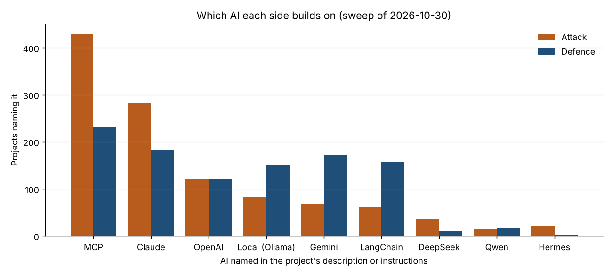

# AI attack and defence tools on GitHub (X25, generated)

Generated by `python -m snapshot.x25report build` from `exploratory/ai_tool_sweeps/`. Do not edit. Exploratory and never scored: a tool on GitHub is supply, not use, and many attack tools serve authorised testing.

**What a sweep covers.** Not all of GitHub: 48 fixed searches (24 for AI attack tools, 24 for AI defence tools, a few in Chinese and Russian; `config/github_tool_queries.yaml`) over the names, descriptions and topic tags of public repositories, forks left out, at most 1,000 results a search. Private repositories, deleted ones and tools described in other words are not seen. The same searches every time, so sweeps compare with each other.

**Roles.** Each repository is labelled by what it does, from its own words: attack (breaks into, scans or exploits systems), defence (detects, investigates, fixes or hardens), both, model testing (tests AI models themselves; kept apart) or unclear. These are first guesses; Claude checks every tool with 100+ stars and the author confirms. The attack and defence searches are not mirror images, so read each side's trend, not the gap between totals.

**Schedule.** Run by hand only: baseline 30 Oct 2026; the January 2027 sweep (6 Jan) is part of the pilot; then mid-2027 (7 Jul) and the end of 2027 (8 Dec).

## Sweep of 2026-10-30

8,758 repositories: attack 2,673, defence 3,734, both 953, model testing 335, unclear 1,063. Stars: attack 248,048, defence 23,115, both 80,059.

*Chart 1. Horizontal: the month each project was created. Vertical: new projects that month. Lines: attack, defence, both.*

*Chart 2. Horizontal: role. Vertical: count on a logarithmic scale. Bars: number of projects and their stars in total.*

*Chart 3. Horizontal: the AI named in a project's description or instructions. Vertical: projects naming it. Bars: attack and defence.*

| Month | 2025-11 | 2025-12 | 2026-01 | 2026-02 | 2026-03 | 2026-04 | 2026-05 | 2026-06 | 2026-07 | 2026-08 | 2026-09 | 2026-10 |
|---|---|---|---|---|---|---|---|---|---|---|---|---|
| Attack | 57 | 64 | 69 | 134 | 184 | 235 | 242 | 232 | 236 | 229 | 224 | 426 |
| Defence | 75 | 97 | 94 | 155 | 235 | 291 | 344 | 421 | 434 | 430 | 454 | 335 |
| Both | 19 | 21 | 24 | 51 | 73 | 73 | 86 | 97 | 112 | 84 | 94 | 119 |

Most-starred attack tools: usestrix/strix (72,940); vxcontrol/pentagi (32,811); promptfoo/promptfoo (26,650); GreyDGL/PentestGPT (16,207); 0x4m4/hexstrike-ai (13,228); AIPentest/CyberStrikeAI (8,254); Giskard-AI/giskard-oss (5,937); oritera/Cairn (4,690).

Most-starred defence tools: baserow/baserow (6,245); alexandreborges/malwoverview (4,135); thalesgroup-cert/Watcher (1,436); FunnyWolf/agentic-soc-platform (1,221); BagelHole/DevOps-Security-Agent-Skills (1,185); Sec-Link/Argus-Agentic-SOC-Platform (1,179); BlessedRebuS/Krawl (825); Nayjest/Gito (456).

Most-starred tools doing both: Dujltqzv/Some-Many-Books (25,461); We5ter/Scanners-Box (9,157); infobyte/faraday (6,836); Trusted-AI/adversarial-robustness-toolbox (6,296); beenuar/AiSOC (5,310); cirosantilli/china-dictatorship (3,298); Armur-Ai/Pentest-Swarm-AI (3,093); jiwoochris/artex-global (2,398).

