# AI attack and defence tools on GitHub (X25, generated)

Generated by `python -m snapshot.x25report build` from `exploratory/ai_tool_sweeps/`. Do not edit. Exploratory and never scored: a tool on GitHub is supply, not use, and many attack tools serve authorised testing.

**What a sweep covers.** Not all of GitHub: 48 fixed searches (24 for AI attack tools, 24 for AI defence tools, a few in Chinese and Russian; `config/github_tool_queries.yaml`) over the names, descriptions and topic tags of public repositories, forks left out, at most 1,000 results a search. Private repositories, deleted ones and tools described in other words are not seen. The same searches every time, so sweeps compare with each other.

**Roles.** Each repository is labelled by what it does, from its own words: attack (breaks into, scans or exploits systems), defence (detects, investigates, fixes or hardens), both, model testing (tests AI models themselves; kept apart) or unclear. These are first guesses; Claude checks every tool with 100+ stars and the author confirms. The attack and defence searches are not mirror images, so read each side's trend, not the gap between totals.

**Privacy.** Repositories owned by individuals appear by project name only, never the owner's username; organisations by full name. The register and the full list are kept privately in the author's Drive (author's decision, 30 Oct 2026; GitHub's Acceptable Use Policies allow research use of public, non-personal information published open access).

**Schedule.** Run by hand only: baseline 30 Oct 2026; the January 2027 sweep (6 Jan) is part of the pilot; then mid-2027 (7 Jul) and the end of 2027 (8 Dec).

## Sweep of 2026-10-30

8,759 repositories: attack 2,684, defence 3,753, both 959, model testing 338, unclear 1,025. Stars: attack 248,447, defence 23,567, both 80,389.

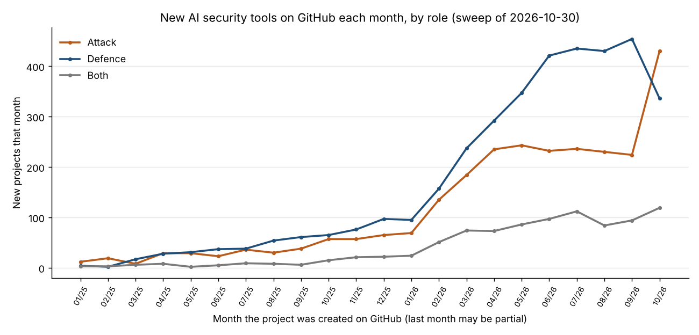

*Chart 1. Horizontal: the month each project was created. Vertical: new projects that month. Lines: attack, defence, both.*

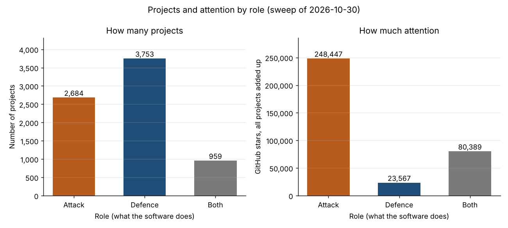

*Chart 2. Two panels. Left: how many projects each role has. Right: how much attention they get, as GitHub stars (bookmarks people give a project) added up over all of that role's projects. Horizontal: role; vertical: the count, written on each bar.*

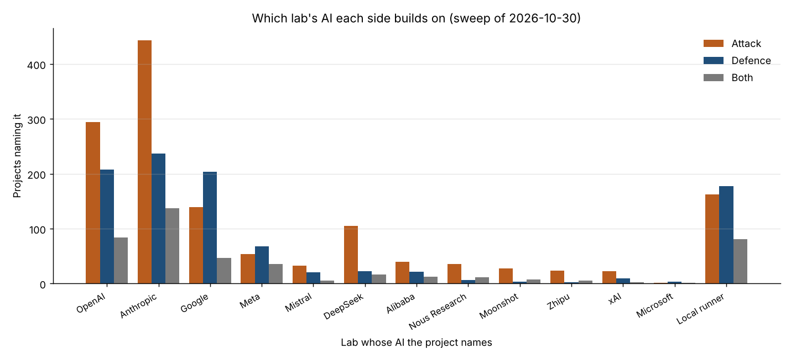

*Chart 3. Horizontal: the lab whose AI a project names (in its description, or its README for the most-starred). Vertical: projects naming it. Bars: attack, defence, both.*

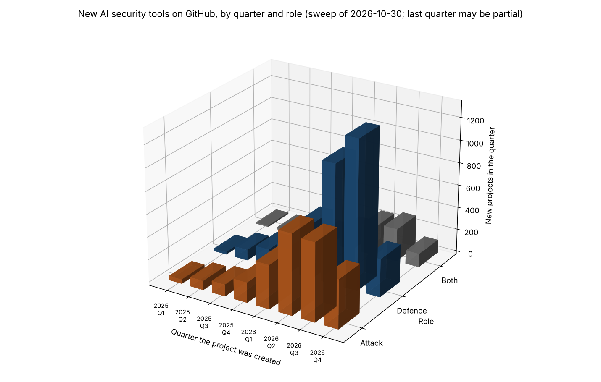

*Chart 4 (overview, author's choice 30 Oct 2026). Left to right: the quarter each project was created. Front to back: attack, defence, both. Height: new projects that quarter. For exact values use charts 1 and 2; in 3D, front bars can hide those behind.*

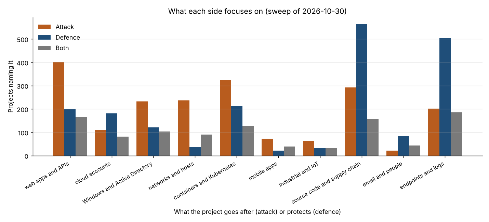

*Chart 5. Horizontal: what a project goes after (attack) or protects (defence). Vertical: projects naming it. Bars: attack, defence, both.*

Agent toolkits named (attack / defence / both): MCP 533/262/109; LangChain 89/172/34; CrewAI 20/18/14; AutoGen 6/6/1; LlamaIndex 2/3/0; Semantic Kernel 3/2/0; OpenAI Agents SDK 19/2/1; Claude Code / Agent SDK 173/71/55; smolagents 3/0/0; PydanticAI 2/6/0.

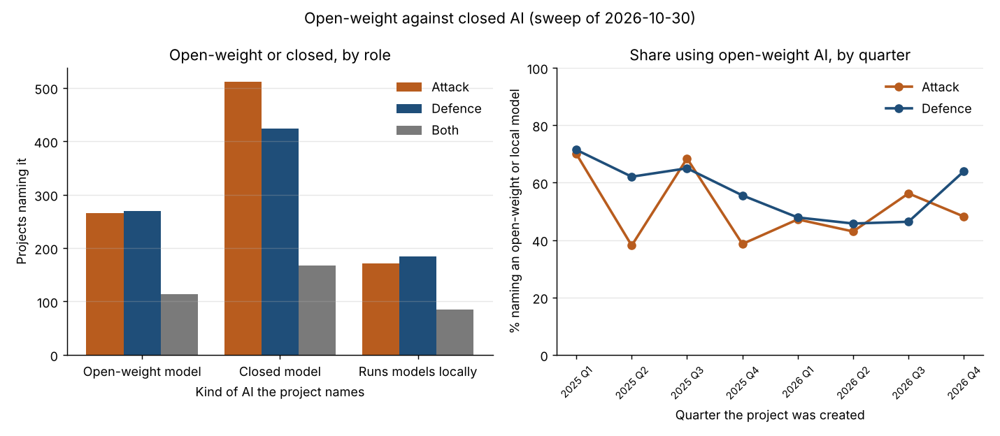

*Chart 6 (author's decision, 30 Oct 2026). Left: projects naming an open-weight model (downloadable, runs anywhere: Llama, Qwen, DeepSeek, Mistral's open models, Hermes, Gemma, gpt-oss), a closed model (used through the maker's service: GPT, Claude, Gemini, Grok) or local running (Ollama and similar); a project can name several. Right: per quarter, the share of projects naming any model that name an open-weight or local one (quarters with fewer than five such projects left out). Decided by model, not lab: Google, OpenAI and Mistral make both kinds.*

Network protocols: 53 of the 57 watched were named, so 5 protocol charts (12 to a chart, most-named first). Not found this sweep: OSPF, XMPP, CoAP, CAN bus.

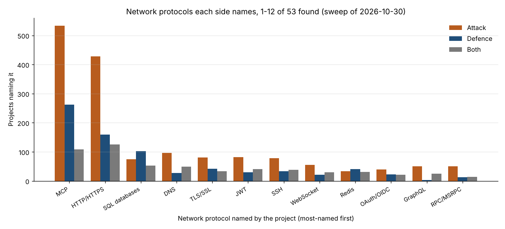

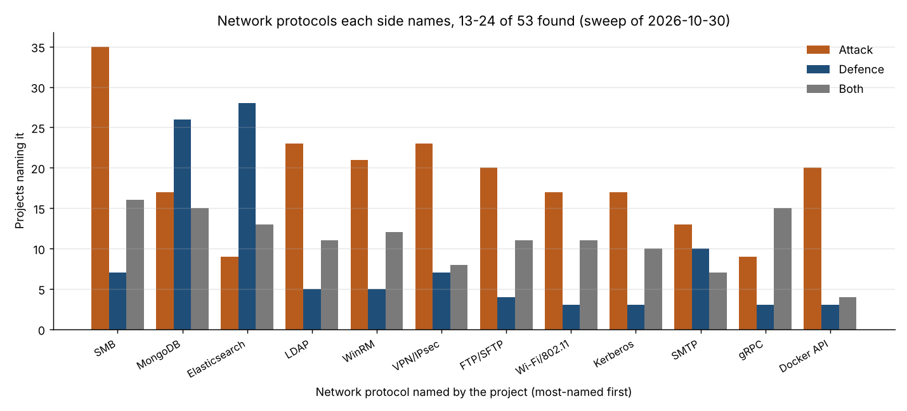

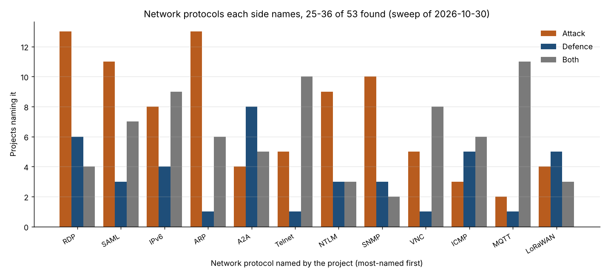

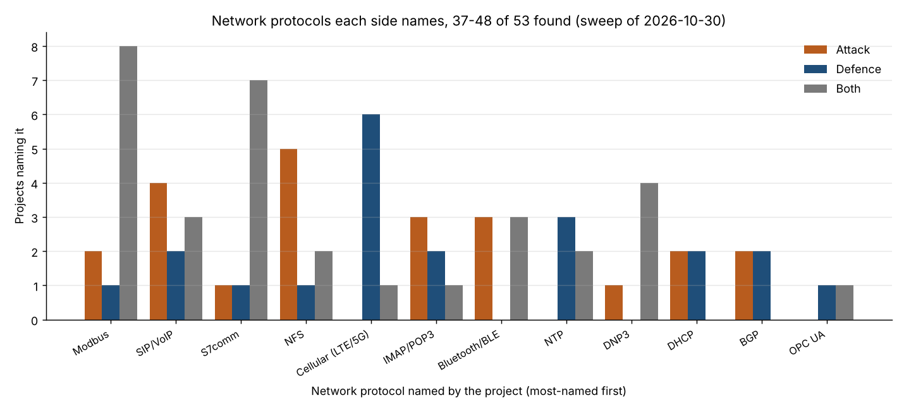

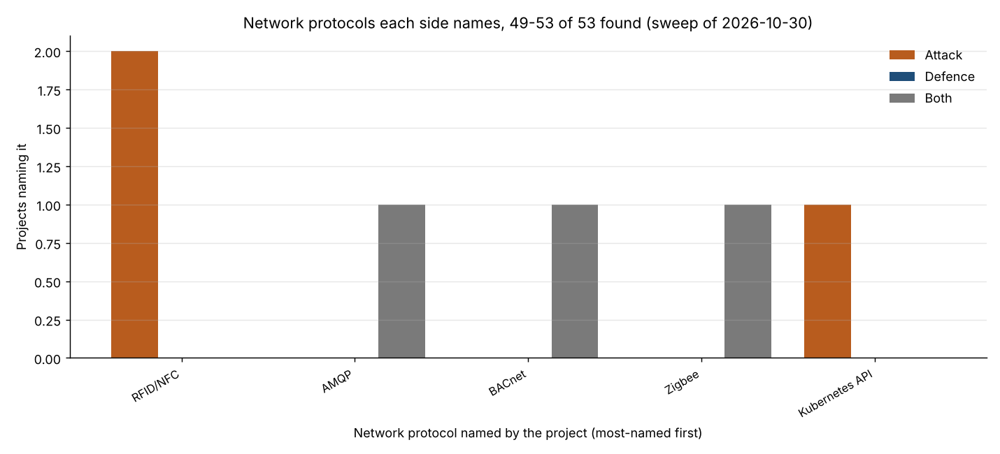

*Protocol charts. Horizontal: the network protocol a project names. Vertical: projects naming it. Bars: attack, defence, both.*

| Month | 2025-11 | 2025-12 | 2026-01 | 2026-02 | 2026-03 | 2026-04 | 2026-05 | 2026-06 | 2026-07 | 2026-08 | 2026-09 | 2026-10 |
|---|---|---|---|---|---|---|---|---|---|---|---|---|
| Attack | 57 | 65 | 69 | 135 | 184 | 235 | 243 | 232 | 236 | 230 | 224 | 430 |
| Defence | 76 | 97 | 95 | 157 | 237 | 292 | 347 | 421 | 435 | 430 | 454 | 336 |
| Both | 21 | 22 | 24 | 51 | 74 | 73 | 86 | 97 | 112 | 84 | 94 | 119 |

Most-starred attack tools: usestrix/strix (72,952); vxcontrol/pentagi (32,815); promptfoo/promptfoo (26,656); PentestGPT (16,208); hexstrike-ai (13,229); AIPentest/CyberStrikeAI (8,255); Giskard-AI/giskard-oss (5,937); oritera/Cairn (4,691).

Most-starred defence tools: baserow/baserow (6,245); malwoverview (4,135); thalesgroup-cert/Watcher (1,436); agentic-soc-platform (1,221); DevOps-Security-Agent-Skills (1,185); Sec-Link/Argus-Agentic-SOC-Platform (1,179); Krawl (825); Gito (456).

Most-starred tools doing both: Some-Many-Books (25,462); Scanners-Box (9,158); infobyte/faraday (6,836); Trusted-AI/adversarial-robustness-toolbox (6,296); AiSOC (5,319); china-dictatorship (3,298); Armur-Ai/Pentest-Swarm-AI (3,093); artex-global (2,400).

