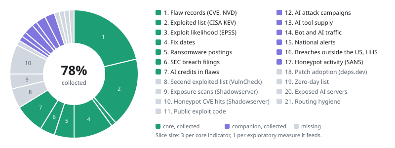
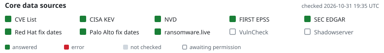

# Landing-page snapshot: baseline, 2026-10-31

Data collected: **78%** of the ring (slices weighted 3 per core indicator, 1 per exploratory measure). Banner checked 2026-10-31 19:35 UTC: 8 ok, 2 pending.

| # | Data | Tier | Collected | Weight |
|---|---|---|---|---|
| 1 | Flaw records (CVE, NVD) | core | yes | 17 |
| 2 | Exploited list (CISA KEV) | core | yes | 14 |
| 3 | Exploit likelihood (EPSS) | core | yes | 1 |
| 4 | Fix dates | core | yes | 8 |
| 5 | Ransomware postings | core | yes | 4 |
| 6 | SEC breach filings | core | yes | 3 |
| 7 | AI credits in flaws | core | yes | 6 |
| 8 | Second exploited list (VulnCheck) | core | no | 4 |
| 9 | Exposure scans (Shadowserver) | core | no | 3 |
| 10 | Honeypot CVE hits (Shadowserver) | core | no | 6 |
| 11 | Public exploit code | companion | no | 1 |
| 12 | AI attack campaigns | companion | yes | 1 |
| 13 | AI tool supply | companion | yes | 1 |
| 14 | Bot and AI traffic | companion | yes | 2 |
| 15 | National alerts | companion | yes | 1 |
| 16 | Breaches outside the US, HHS | companion | yes | 2 |
| 17 | Honeypot activity (SANS) | companion | yes | 2 |
| 18 | Patch adoption (deps.dev) | companion | no | 1 |
| 19 | Zero-day list | companion | no | 1 |
| 20 | Exposed AI servers | companion | no | 1 |
| 21 | Routing hygiene | companion | no | 1 |
