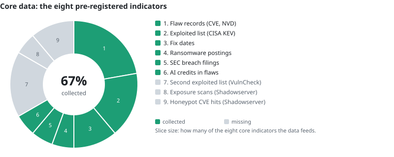
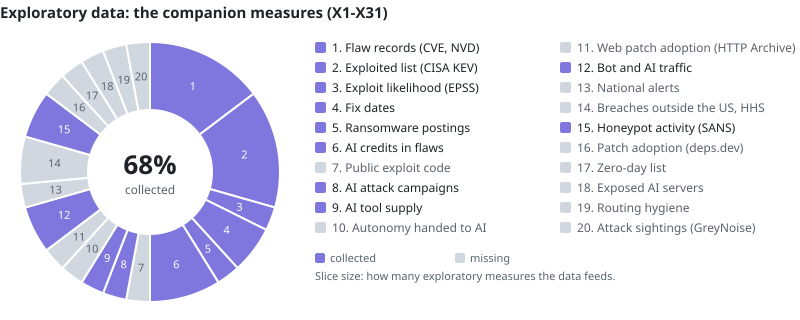
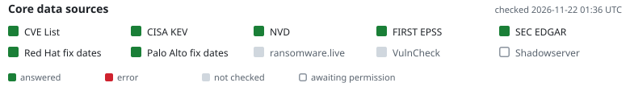

# Landing-page snapshot: cutover, 2026-11-23

Captured 2026-11-23 00:46 UTC.

Data collected: core **67%**, exploratory **68%** (two separate rings). Banner checked 2026-11-22 01:36 UTC: 7 ok, 1 pending, 2 unchecked.

| # | Data | Collected | Core indicators fed | Exploratory measures fed |
|---|---|---|---|---|
| 1 | Flaw records (CVE, NVD) | yes | 4 | 5 |
| 2 | Exploited list (CISA KEV) | yes | 3 | 5 |
| 3 | Exploit likelihood (EPSS) | yes | 0 | 1 |
| 4 | Fix dates | yes | 2 | 2 |
| 5 | Ransomware postings | yes | 1 | 1 |
| 6 | SEC breach filings | yes | 1 | 0 |
| 7 | AI credits in flaws | yes | 1 | 3 |
| 8 | Second exploited list (VulnCheck) | no | 3 | 0 |
| 9 | Exposure scans (Shadowserver) | no | 1 | 0 |
| 10 | Honeypot CVE hits (Shadowserver) | no | 2 | 0 |
| 11 | Public exploit code | no | 0 | 1 |
| 12 | AI attack campaigns | yes | 0 | 1 |
| 13 | AI tool supply | yes | 0 | 1 |
| 14 | Autonomy handed to AI | no | 0 | 1 |
| 15 | Web patch adoption (HTTP Archive) | no | 0 | 1 |
| 16 | Bot and AI traffic | yes | 0 | 2 |
| 17 | National alerts | no | 0 | 1 |
| 18 | Breaches outside the US, HHS | no | 0 | 2 |
| 19 | Honeypot activity (SANS) | yes | 0 | 2 |
| 20 | Patch adoption (deps.dev) | no | 0 | 1 |
| 21 | Zero-day list | no | 0 | 1 |
| 22 | Exposed AI servers | no | 0 | 1 |
| 23 | Routing hygiene | no | 0 | 1 |
| 24 | Attack sightings (GreyNoise) | no | 0 | 1 |
